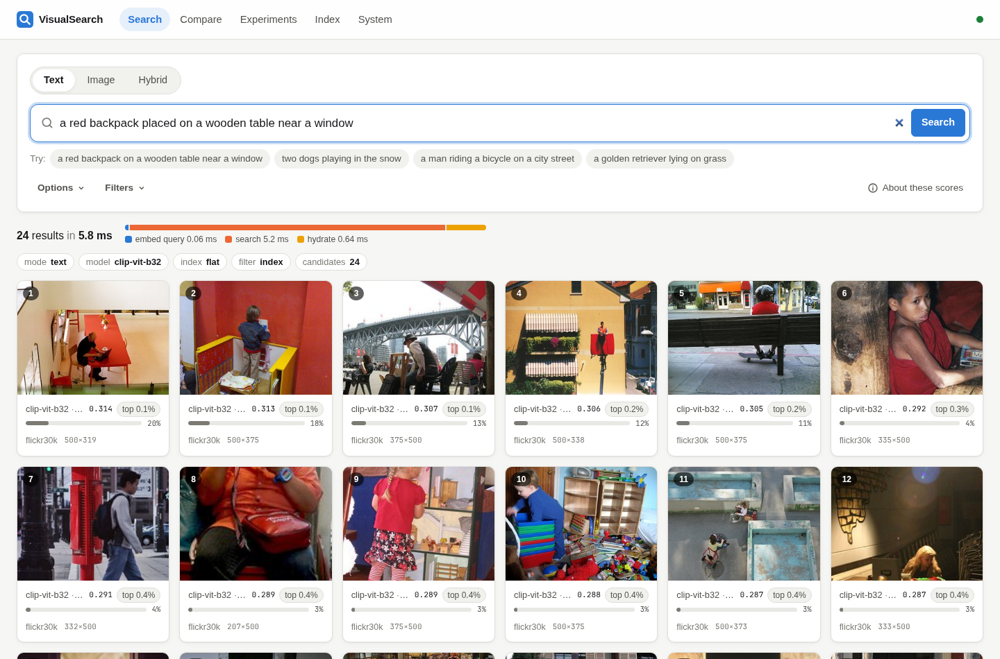
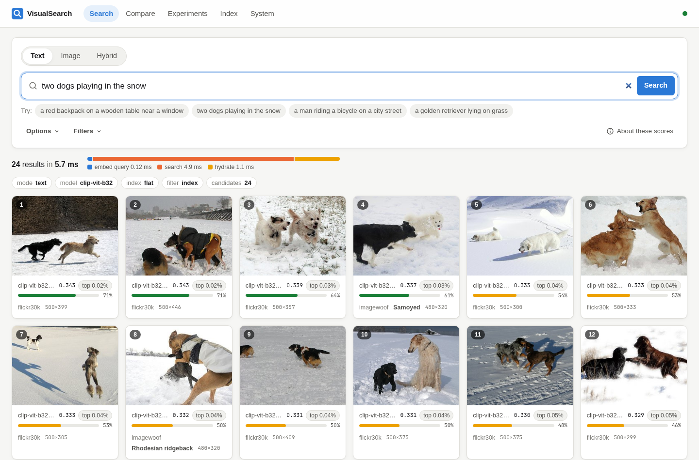
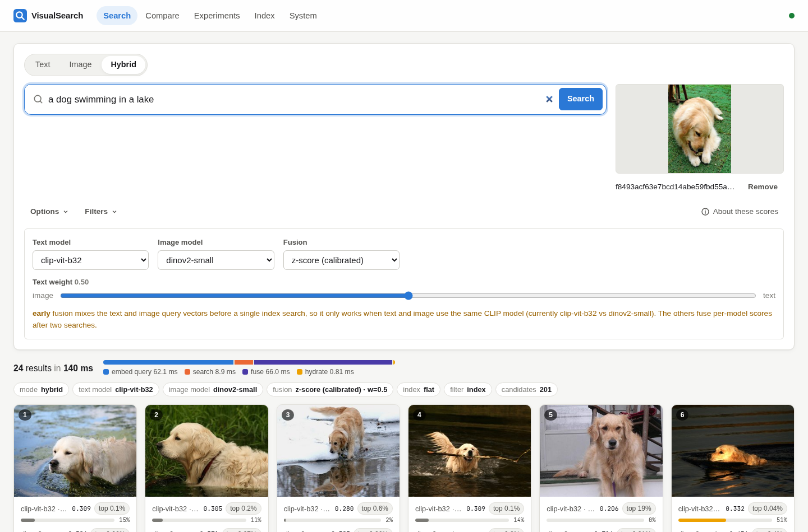
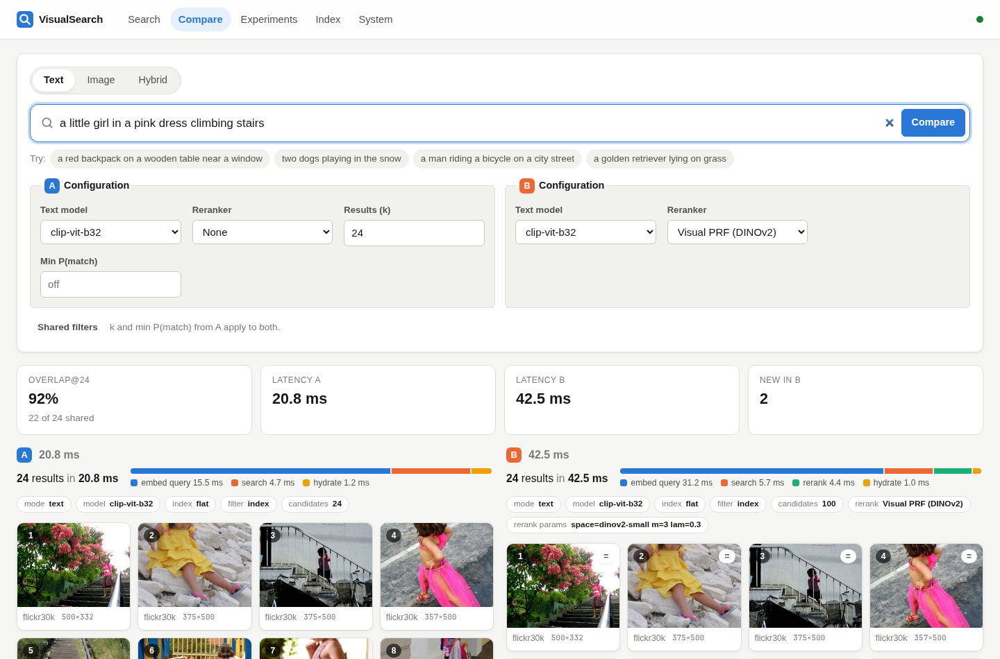

# VisualSearch

Multimodal semantic image search: find images by **natural-language description**, by
**example image**, or by **both** (with metadata filters), using pretrained vision-language
(CLIP) and self-supervised visual (DINOv2) representations, FAISS/Qdrant vector indexes, score
calibration, fusion and reranking, with a reproducible evaluation suite.



<!-- RESULTS:START -->
## Results at a glance

All numbers are on held-out test data, with every setting chosen on validation data. Full
analysis: [docs/REPORT.md](docs/REPORT.md). Generated tables with confidence intervals:
[docs/REPORT_TABLES.md](docs/REPORT_TABLES.md).

| | Result |
|---|---|
| Text→image, Flickr30k-1K, CLIP ViT-B/32 baseline | R@1 **58.8** · R@10 90.1 (matches published zero-shot numbers) |
| + larger model (CLIP ViT-L/14) | R@1 **64.7** (+5.9, p < 0.001) |
| + BLIP cross-encoder reranking of the top 20 | R@1 **83.2** (+24.4 over baseline), ~0.5 s/query |
| Image→image, Imagewoof breeds (mAP) | CLIP B/32 36.8 · CLIP L/14 49.6 · **DINOv2-B 82.5** |
| Hybrid: breed name + example image (mAP) | best single signal 83.0 → **89.6** (CLIP text + DINOv2-B, z-score fusion) |
| Hybrid: caption + 15–25% crop, 31K gallery (R@1) | 24.7 (text) / 74.1 (crop) → **85.3** fused |
| Exact vs HNSW, 181K vectors | 21 ms → 0.18 ms at 98.4% recall@10 |
| Filters selecting 1% of images | post-filtering 4.5% recall · HNSW+selector 60% · **planner (exact subset) 100%, 0.25 ms** |
| Serving latency (GPU, 36K images, exact) | text ~17–26 ms p50 · image upload ~24–35 ms · hybrid ~43 ms |

Things that did **not** help, also reported: letterbox padding (−3.4 R@1), pseudo-relevance
feedback for text queries (no significant change), mean-pooled DINOv2 features, rank-based (RRF)
fusion, and post-filtering.

| Search | Hybrid | Compare strategies |
|---|---|---|
|  |  |  |
<!-- RESULTS:END -->

## Contents

- [Quick start](#quick-start)
- [What's in the box](#whats-in-the-box)
- [Data](#data)
- [Reproducing the experiments](#reproducing-the-experiments)
- [Design decisions](#design-decisions)
- [Limitations](#limitations)
- [Future work](#future-work)
- Docs: [architecture](docs/ARCHITECTURE.md) · [API](docs/API.md) · [deployment](docs/deployment.md) · [experimental report](docs/REPORT.md) · [generated result tables](docs/REPORT_TABLES.md) · [plan](docs/PLAN.md)

## Quick start

Requirements: Python 3.11–3.12 with [uv](https://docs.astral.sh/uv/), Node ≥ 20 for the UI,
~7 GB disk for data (4.3 GB images, the rest thumbnails, embeddings and indexes) plus
~5.4 GB for all model weights. A GPU is optional (see
[hardware](#hardware)).

```bash
# 1. Install (pick ONE torch build)
uv sync --extra cpu  --extra dev --extra qdrant --extra report   # CPU-only, ~0.8 GB torch
uv sync --extra cuda --extra dev --extra qdrant --extra report   # NVIDIA GPU, CUDA 13 wheels

# 2. Data: Flickr30k (pinned HF revision, fetched member-by-member) + Imagewoof
uv run visualsearch data flickr30k --distractors 29000   # ~10 min, 4.3 GB
uv run visualsearch data imagewoof                       # ~5 min, 0.3 GB
#    (use --distractors 0 for a 2k-image demo that downloads ~300 MB)

# 3. Embeddings + serving indexes for the active models (configs/default.yaml)
uv run visualsearch embed --models clip-vit-b32 dinov2-small
uv run visualsearch calibrate --models clip-vit-b32 dinov2-small   # val-only fit
uv run visualsearch index build

# 4. Serve the API (http://127.0.0.1:8000/docs) and the UI (http://127.0.0.1:5173)
uv run visualsearch serve
cd frontend && npm install && npm run dev
```

Your own images: `uv run visualsearch ingest ~/Pictures --collection mine --tag holiday --sync`,
or upload them in the UI's **Index** tab (`POST /api/v1/index/images`, a background job).

### Docker

```bash
docker compose up --build              # UI on http://localhost:8080, API on :8000
docker compose --profile qdrant up     # also start a Qdrant server
```

The image is CPU-only (the portable choice; this machine has no NVIDIA container runtime).
`./data` is mounted into the container: build it with the CLI first, or the API will build
indexes for whatever the catalogue holds on first start. Model weights are cached in a volume.

[docs/deployment.md](docs/deployment.md) covers running it on a single server: HTTPS with
Caddy, provisioning models and indexes, upgrades and sizing.

### Tests

```bash
uv run pytest            # 96 fast tests (fake embedder, no downloads), ~20 s
uv run pytest -m slow    # real CLIP/DINOv2 checks (dims, normalisation, alignment)
cd frontend && npm test && npm run typecheck && npm run build
```

## What's in the box

| Capability | Where |
|---|---|
| Text→image, image→image, hybrid search; metadata filters; "find similar" | `retrieval/engine.py`, `POST /api/v1/search/*` |
| CLIP ViT-B/32, B/16, L/14 and DINOv2-S/B behind a model registry (add a model with a YAML entry) | `embeddings/`, `configs/models.yaml` |
| Embedding cache keyed by (model fingerprint, image SHA-256); batch inference, configurable batch size | `embeddings/store.py` |
| FAISS flat / HNSW / IVF-Flat / IVF-PQ, optional Qdrant; persistence; incremental adds; deletes; filtered search planner; automatic rebuild on model/preprocessing change | `index/` |
| Score calibration (background z-score, percentile, Platt P(match)) fitted on validation data | `retrieval/calibration.py` |
| Late fusion (z-score, min-max, RRF) and CLIP early fusion | `retrieval/fusion.py` |
| Rerankers: pseudo-relevance feedback (same space or DINOv2 space), BLIP ITM cross-encoder | `retrieval/rerank.py`, `retrieval/cross_encoder.py` |
| Data pipeline: pinned acquisition with checksums, validation, EXIF handling, exact + perceptual dedup, thumbnails, manifests | `data/`, `pipeline/ingest.py` |
| Evaluation: R@K, MRR, mAP, clustered bootstrap CIs, paired significance tests; 11 experiments → `results/*.json` | `eval/`, `scripts/run_experiments.py` |
| FastAPI service: validation, upload limits, uniform error envelope, background index jobs, metrics (JSON + Prometheus) | `api/` |
| React UI: search (3 modes), filters, score explanations, detail view, A/B compare, experiment browser, upload/index, system status | `frontend/` |

## Data

| Dataset | Used for | What is ingested | Labels |
|---|---|---|---|
| **Flickr30k** (`nlphuji/flickr30k` @ `2b239bef`), Karpathy split | text↔image retrieval; gallery for ANN, filters, instance-level image search | test 1,000 + val 1,014 + all train images as distractors (28,994 after dedup) | 5 human captions per image |
| **Imagewoof** (fast.ai, 320 px) | category-level image↔image retrieval, hybrid | val 3,928 (eval) + seeded 1,050 train (tuning) | ImageNet breed labels (10 classes) |

- Flickr30k ships as a single 4.4 GB zip. `data/remote_zip.py` reads its central directory and
  fetches each needed member with one HTTP range request, verifying CRC-32. The annotation CSV and the
  Imagewoof archive are checked against pinned SHA-256 values, and manifests (`data/manifests/`) record
  revisions, seeds, counts and deduplication outcomes.
- **Licences**: Flickr30k annotations are for non-commercial research. Images remain under their
  owners' Flickr terms. Imagewoof follows ImageNet's terms (non-commercial research). Nothing is
  redistributed in this repository.
- **Splits & leakage control**: all tuning (fusion weights, reranker hyper-parameters, calibration)
  uses Flickr30k **val** or Imagewoof **train**. Test is only evaluated. Train distractors that are
  perceptual near-duplicates of earlier images are skipped, so they cannot become unlabeled positives.

## Reproducing the experiments

```bash
TORCH=cuda scripts/reproduce.sh          # data → embeddings → calibration → experiments → report
uv run python scripts/run_experiments.py --only ann rerank   # or individual experiments
uv run python scripts/make_report.py     # results/*.json → docs/REPORT_TABLES.md + figures
```

Every result file records the git commit, library versions, hardware, seed and dataset
provenance. `docs/REPORT_TABLES.md` is generated from those files, never hand-edited.

## Design decisions

- **Never compare vectors across embedding spaces.** CLIP text and CLIP image vectors share an
  aligned space. DINOv2 vectors don't, and DINOv2 has no text encoder. Each model gets its own index.
  Text queries always go through CLIP. Hybrid search combines **scores** from separate indexes after
  normalising each by its own background distribution. Blending query **vectors** (early fusion) is
  only allowed for CLIP text + CLIP image.
- **Inner product on L2-normalised vectors** is cosine similarity, used for every index. Index
  `add()` rejects unnormalised vectors.
- **Fingerprinted embeddings.** A model's fingerprint covers weights revision, pooling, crop mode,
  normalisation and image-processor config. Caches and index manifests are keyed by it, so changing
  any of these triggers a re-embed and rebuild, while unchanged content is never recomputed.
- **Filter planning instead of post-filtering.** Selective filters are answered by an exact scan of
  the allowed subset; broad ones by an ID-selector traversal of the ANN index. Post-filtering is
  measured to lose results (see the report).
- **Exact search is the serving default.** At 36k vectors, flat search costs a few milliseconds and
  gives perfect recall. ANN indexes are implemented and benchmarked, and selectable with `VS_INDEX_TYPE`.
- **Calibrated, explained scores.** The UI shows raw cosine, a percentile against random pairs,
  and a calibrated P(match), along with what each one means and doesn't mean.

## Hardware

| | Used for the reported numbers | Minimum |
|---|---|---|
| CPU | 12-thread laptop CPU (see `results/*.json` → `environment`) | any x86-64 / arm64 |
| GPU | NVIDIA RTX 4050 Laptop, 6 GB | none: everything runs on CPU (`VS_DEVICE=cpu`), embedding is ~10–20× slower |
| RAM | 16 GB | serving B/32 + DINOv2-S over 36k images measured at 1.8 GB RSS (+0.9 GB VRAM on GPU); allow ~4 GB on CPU-only. 8 GB for the experiment suite |
| Disk | ~7 GB data + ~5.4 GB weights (all six models) | ~1.3 GB with `--distractors 0` and two models (Imagewoof is still needed: image-score calibration is fitted on its train split) |

## Limitations

- **Evaluation labels are sparse.** Each Flickr30k caption has exactly one annotated image. The
  failure analysis finds that about a quarter of top-1 "errors" are plausibly correct, so absolute
  R@1 understates real quality.
- **Short queries are the weak spot**: ≤ 8-word queries reach 51% R@1 vs 68% for ≥ 18 words.
  CLIP is also known to struggle with counting, negation and spatial relations; the Flickr30k test
  set can't measure that well, because its targets are usually distinguishable without them (§7 of
  the report).
- **Image↔image category evaluation is one domain** (dog breeds). DINOv2's large advantage there is
  a fine-grained-visual result and doesn't transfer to every notion of "similar".
- **The hybrid evaluations are constructed tasks** (breed name + exemplar; caption + crop) built
  from real labels, not a composed-retrieval benchmark such as CIRR.
- **Throughput and latency** are single-machine laptop numbers. The ANN benchmark tops out at
  ~181k vectors, where exact search is still viable. The embedded Qdrant mode is exact brute force
  in Python and not representative of a Qdrant server.
- **Calibrated probabilities** are relative to annotation-based relevance and dataset base rates.
  Read them as a ranking aid, not literal probabilities, especially on your own images.
- The BLIP cross-encoder adds substantial latency per query and is opt-in.

## Future work

- Composed-retrieval training/evaluation (CIRR, FashionIQ) to learn the hybrid combination.
- Larger and multilingual encoders (SigLIP 2, EVA-CLIP), and distillation for CPU serving.
- Region-level indexing (object crops) for small-object queries.
- Learned score fusion and query-dependent weights; online feedback.
- Sharded embedding storage and a real Qdrant/Milvus deployment benchmark at ≥10⁷ vectors.
