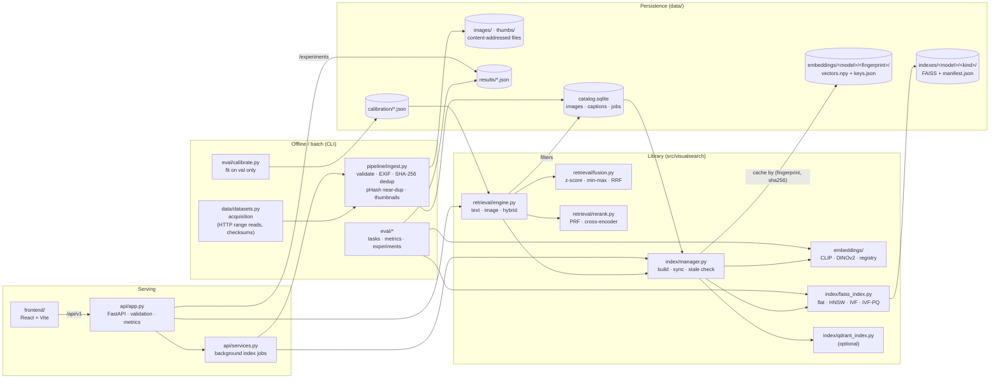

# Architecture

## Component overview



## Query path

```mermaid
sequenceDiagram
    participant UI
    participant API as FastAPI handler
    participant E as SearchEngine
    participant M as Embedder
    participant C as Catalog (SQLite)
    participant I as VectorIndex

    UI->>API: POST /search/hybrid (text, image, filters)
    API->>API: size cap, decode + validate image (thread pool)
    API->>E: hybrid(text, image, filters, weight, fusion)
    E->>M: CLIP text vector; image vector in chosen space
    E->>C: resolve filters -> allowed ids
    E->>I: top-C per signal (exact subset scan if filter is selective, else IDSelector)
    E->>I: stored vectors of candidate union
    E->>E: score both signals on the union, z-normalise (val stats), weighted sum
    E-->>API: hits + per-signal raw/z/percentile/P(match) + stage timings
    API->>C: hydrate metadata
    API-->>UI: SearchResponse
```

## Key design decisions

**One index per embedding space; never compare vectors across spaces.** CLIP
text and image vectors share an aligned space; DINOv2 vectors live in a
different, image-only space. A DINOv2 vector is never scored against a CLIP
vector. Cross-space combination (CLIP text + DINOv2 image) happens only at the
*score* level, after each signal has been normalised by statistics of its own
score distribution (`retrieval/calibration.py`, `retrieval/fusion.py`). Blending
query *vectors* ("early fusion") is allowed only for CLIP text + CLIP image.

**Embedding fingerprints.** Each embedder's fingerprint hashes the weights
revision, pooling, crop mode, normalisation and the image-processor
configuration. The embedding cache is keyed by `(fingerprint, content SHA-256)`,
so re-ingesting or renaming an image never recomputes it, and any change that
alters vectors lands in a new cache directory. Index manifests record the
fingerprint they were built with; a mismatch on start-up triggers a rebuild.

**Ingestion is decoupled from indexing.** `Ingestor` validates, deduplicates,
stores and catalogues images. `IndexManager.sync` then embeds whatever each index
lacks (cache misses only) and tombstones deleted images. The API's background
job runs ingest followed by sync; the CLI exposes the same steps.

**Catalogue ids are the index ids.** The FAISS wrapper keeps its own
position-to-id table instead of `IndexIDMap`, so all index kinds support ids,
filtering (via `IDSelectorBatch`) and deletion (tombstones + compaction)
identically.

**Filter planning.** Filters resolve to an allow-list in SQLite. If it selects at
most `brute_force_filter_threshold` images, those vectors are scanned exactly
(cheap and always correct); otherwise the ANN index is traversed with an ID
selector. Post-filtering is avoided because it silently returns fewer than *k*
results for selective filters (measured in `results/filtered_search.json`).

**Calibration from validation data only.** Raw cosine scores are not comparable
across spaces or query modalities. Background mean/std/quantiles and a Platt
scaler are fitted on validation data; the UI shows the raw cosine, a percentile
against random pairs, and a calibrated P(match), with their caveats.

**Concurrency.** Search handlers run in the thread pool. Each index is guarded
by a writer-preferring readers-writer lock: many concurrent searches, exclusive
adds/removes. Indexing jobs run one at a time on a dedicated worker thread;
uploads are spooled to disk first.

## Module map

| Concern | Module |
|---|---|
| Configuration | `config.py`, `configs/default.yaml`, `configs/models.yaml` |
| Dataset acquisition | `data/datasets.py`, `data/remote_zip.py` |
| Image validation, hashing, thumbnails | `data/preprocess.py` |
| Metadata persistence, filters, jobs | `data/catalog.py` |
| Ingestion | `pipeline/ingest.py` |
| Embedding models + registry | `embeddings/base.py`, `embeddings/hf.py`, `embeddings/fake.py` |
| Embedding cache | `embeddings/store.py` |
| Vector indexes | `index/faiss_index.py`, `index/qdrant_index.py`, `index/base.py` |
| Index lifecycle | `index/manager.py` |
| Search, fusion, reranking, calibration | `retrieval/*.py` |
| Evaluation metrics, tasks, experiments | `eval/metrics.py`, `eval/tasks.py`, `eval/experiments/*.py` |
| HTTP API | `api/app.py`, `api/schemas.py`, `api/services.py` |
| UI | `frontend/` |
