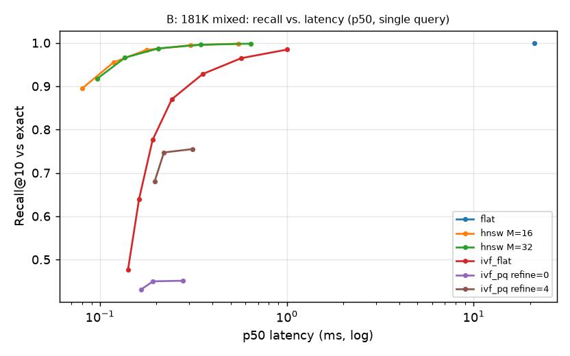

# Experimental report

This report explains what was measured, how, and what the results mean. Every number here comes
from `results/*.json`; the complete generated tables (with confidence intervals, provenance and
figures) are in [`REPORT_TABLES.md`](REPORT_TABLES.md). To regenerate everything, run
`scripts/reproduce.sh`.

## Summary

| Question | Answer (test data; details in the numbered sections) |
|---|---|
| Does the baseline reproduce? | Yes: CLIP B/32 text→image R@1 58.8 on Flickr30k-1K, in line with published zero-shot results (§3). |
| Best text→image model? | CLIP L/14: +5.9 R@1 over B/32 on 1K images, +7.5 on 30K (§4.1). |
| Best image→image model? | DINOv2, by far for fine-grained similarity: 82.5 vs 36.8 mAP (DINOv2-B vs CLIP B/32), CLS pooling (§4.2). |
| Biggest single improvement? | BLIP cross-encoder reranking of the top 20: R@1 58.8 → 83.2, at ~25× query cost (§9). |
| Does hybrid search help? | Yes, when the signals are complementary: CLIP text + DINOv2 image +6.6 mAP / +11.2 R@1; z-score fusion is best, RRF worst (§8). |
| What didn't work? | Letterbox padding (−3.4 R@1), pseudo-relevance feedback for text queries (±0.2, n.s.), mean-pooled DINOv2 patches (−37 mAP), post-filtering (near-zero recall on selective filters). |
| Exact or approximate search? | Exact at 36k vectors (3.7 ms). HNSW at 181k (≥ 98% recall, ~100× faster). The text–image modality gap makes ANN harder than image benchmarks suggest (§10). |
| How much of the remaining error is real? | ~24% of top-1 failures are plausibly correct images that the one-caption-one-image labels count as wrong (§7). |

## 1. Setup

**Hardware.** Laptop, 12-thread x86-64 CPU, NVIDIA RTX 4050 Laptop GPU (6 GB), 16 GB RAM.
Embedding uses the GPU in fp32 with TF32 disabled (CPU- and GPU-computed vectors agree to
4.4e-6 max abs difference; checked on 64 images). FAISS runs on the CPU.

**Models** (pinned Hub revisions, `configs/models.yaml`):

| Key | Model | Space | Dim | Text encoder |
|---|---|---|---|---|
| `clip-vit-b32` | OpenAI CLIP ViT-B/32 | CLIP-B/32 | 512 | yes |
| `clip-vit-b16` | OpenAI CLIP ViT-B/16 | CLIP-B/16 | 512 | yes |
| `clip-vit-l14` | OpenAI CLIP ViT-L/14 (224 px) | CLIP-L/14 | 768 | yes |
| `dinov2-small` | DINOv2 ViT-S/14, CLS token | DINOv2-S | 384 | no |
| `dinov2-base` | DINOv2 ViT-B/14, CLS token | DINOv2-B | 768 | no |
| BLIP ITM | `Salesforce/blip-itm-base-coco` (reranker only) | — | — | cross-encoder |

**Data.** Flickr30k with the Karpathy split (test 1,000 images / 5,000 captions; val 1,014 / 5,070;
all 28,994 train images as distractors after deduplication), and Imagewoof (val 3,928 for
evaluation; a seeded 1,050-image train subset for tuning). See the README for acquisition,
licences and deduplication.

**Protocol.**

1. All tuning (fusion weights, reranker hyper-parameters, Platt scaling and background
   statistics) uses Flickr30k **val** or Imagewoof **train** only. Test is evaluated once per
   configuration; nothing was chosen by looking at it.
2. Exact (flat) search unless the experiment is about indexing.
3. Uncertainty: 95% percentile-bootstrap confidence intervals (1,000 resamples). For text→image,
   resampling is **clustered by target image**, because an image's five captions are not
   independent queries. Differences between configurations use a paired bootstrap on the same
   queries (2,000 resamples) and report the mean difference, its CI and a two-sided p-value.
4. Ranking depth is capped at 1,000 for R@K/MRR tasks (this changes MRR by < 0.001 per query);
   category-level image retrieval ranks the full gallery because mAP needs it.
5. Every result file records the git commit it was produced from. Re-running the deterministic
   experiments (calibration, model comparisons, preprocessing, failure analysis) at a later
   commit reproduced every table cell exactly; only wall-clock timings vary between runs.

## 2. Tasks and relevance labels

| Task | Queries | Gallery | Relevant | Metrics |
|---|---|---|---|---|
| T→I (1K) | 5,000 test captions | 1,000 test images | the caption's image (exactly 1) | R@1/5/10, MRR, median rank |
| T→I (full) | 5,000 test captions | 30,000 images (test + train distractors) | same | same |
| I→T | 1,000 test images | 5,000 test captions | the image's 5 captions | R@K, MRR, **mAP** |
| I→I category | 3,928 Imagewoof val images (leave-one-out) | the other 3,927 | same breed (~390 each) | **mAP**, P@1, P@10 |
| I→I instance | 1,000 transformed Flickr test images | 30,000 images | the untransformed original | R@1/10, MRR, by transformation |
| Hybrid (Imagewoof) | breed-name prompt + one image of that breed | val images | same breed | mAP, P@1, P@10 |
| Hybrid (Flickr30k) | first caption + 15–25%-area crop of the target | 31,014 images | the target | R@1/5/10 |

With exactly one relevant item, AP equals reciprocal rank, so mAP is only reported where queries
have several relevant items. Text→image and image→image results are never pooled: they use
different labels and answer different questions.

## 3. Baseline: CLIP ViT-B/32, exact search

| Flickr30k 1K test | R@1 | R@5 | R@10 | MRR |
|---|---|---|---|---|
| Text→image | 58.8 [56.6, 60.8] | 83.4 | 90.1 | 69.7 |
| Image→text | 79.3 [76.7, 81.8] | 95.0 | 98.1 | 86.0 (mAP 64.2) |

These match the zero-shot numbers commonly reported for this checkpoint (text→image R@1 ≈ 59,
image→text R@1 ≈ 79), which checks the whole chain: acquisition, the Karpathy split,
preprocessing, embedding extraction, and the metric code. All later changes are compared against
this baseline.

## 4. Embedding models

### 4.1 Text ↔ image (CLIP only; DINOv2 has no text tower)

| Model | T→I R@1, 1K gallery | Δ vs B/32 [95% CI] | T→I R@1, 30K gallery | Δ vs B/32 | I→T R@1 | I→T mAP |
|---|---|---|---|---|---|---|
| CLIP B/32 | 58.8 | — | 19.8 | — | 79.3 | 64.2 |
| CLIP B/16 | 62.2 | +3.4 [+1.6, +5.0] | 23.2 | +3.3 | 82.4 | 67.0 |
| CLIP L/14 | **64.7** | **+5.9 [+3.9, +7.8]** | **27.4** | **+7.5** | **85.3** | **71.0** |

All differences are significant (paired clustered bootstrap, p < 0.001). Two observations:

- **Scale helps, and helps more in a larger gallery.** L/14's margin over B/32 grows from +5.9
  to +7.5 points once 29k distractors are added. Finer distinctions matter more when there are
  more near-misses to separate.
- **The 30K gallery is much harder than the standard 1K protocol** (R@1 drops from 58.8 to
  19.8 for B/32). Part of this is genuine difficulty, and part is label sparsity: many
  distractors are plausibly correct answers to generic captions (see §7). The 1K protocol
  overstates what a user of a real-sized collection experiences.

### 4.2 Image ↔ image

**Category level** (Imagewoof, 10 dog breeds, leave-one-out over 3,928 images):

| Model | mAP | P@1 | P@10 |
|---|---|---|---|
| CLIP B/32 | 36.8 | 79.9 | 73.0 |
| CLIP B/16 | 40.0 | 84.0 | 77.7 |
| CLIP L/14 | 49.6 | 89.6 | 85.5 |
| DINOv2-S (CLS) | 75.0 | 93.7 | 91.2 |
| DINOv2-B (CLS) | **82.5** | **94.8** | **93.3** |

DINOv2 is far better at fine-grained visual similarity: even the small model doubles CLIP B/32's
mAP. CLIP is trained to match captions, which rarely name dog breeds, so its image space groups
"dogs in similar scenes" rather than "dogs of the same breed". This is why the serving default
for image search is DINOv2-S, and text search stays on CLIP. Per class, DINOv2-B is weakest on
*English foxhound* (43.7 mAP, vs 96.3 for Samoyed), the breed most easily confused with beagle;
the deduplication pass found the same photograph labelled under both breeds in Imagewoof val.

**DINOv2 pooling ablation.** The CLS token is the best descriptor. Mean-pooled patch tokens
collapse to 37.7 mAP (S), and concatenating CLS + mean is slightly *worse* than CLS alone
(72.0 vs 75.0 for S; 80.9 vs 82.5 for B). The linear-probe descriptor isn't the best retrieval
descriptor.

**Instance level** (one transformed copy of each Flickr30k test image against 30,000 images):
every model finds the original at R@1 ≥ 96.4%. DINOv2-B is best (98.3), and
horizontal-flip + 30–60% crop is the hardest transformation for every model (91–94.5). Near-copy
detection is easy for all of these representations; the models only separate on semantic
similarity.

## 5. Preprocessing

| Variant (CLIP B/32) | Split | T→I R@1 | Δ vs default [95% CI] |
|---|---|---|---|
| default: resize + centre crop | val | 59.7 | — |
| letterbox pad to square | val | 57.1 | −2.6 [−4.5, −0.9] |
| prompt `a photo of {}` | val | 61.5 | +1.8 [+1.0, +2.5] |
| default | test | 58.8 | — |
| letterbox pad to square | test | 55.4 | **−3.4 [−5.1, −1.6]** |
| prompt `a photo of {}` | test | 59.7 | **+0.9 [+0.1, +1.6]** |

- **Padding hurts**, against my expectation. I expected it to help wide images whose edges the
  centre crop discards. In practice the whole image shrinks to fit 224 px and gains borders the
  model never saw in training. Image→image suffers too (−5.3 mAP for CLIP, −0.7 for DINOv2-S).
  Centre crop stays the default.
- **The prompt template helps slightly.** It was chosen on val and confirmed on test, where
  the gain is about half the val gain. It is available as `text_query_template`, but **off by
  default**: calibration and fusion weights were fitted on raw text, and enabling it shifts the
  score distribution they rely on. Turning it on means refitting both.

## 6. Score calibration

Raw cosine scores live on very different scales: CLIP text→image background mean 0.17 (std
0.04), CLIP image→image 0.49 (std 0.09), DINOv2-S image→image 0.09 (std 0.09). Adding them
directly lets the larger-scale signal dominate, which is why fusion standardises each signal by its
own background (§8).

Platt-scaled P(match) is well calibrated over all pairs (held-out ECE ≤ 0.017 for image
queries). For text, the global ECE (0.0001) is uninformative because 99.9% of pairs are trivial
negatives. The useful test is the **top-1 result**:

| Top-1 P(match) bin | Queries | Mean predicted | Observed precision@1 |
|---|---|---|---|
| [0, 0.05) | 641 | 2.5 | 34.2 |
| [0.10, 0.20) | 706 | 14.6 | 47.6 |
| [0.30, 0.50) | 774 | 39.0 | 61.1 |
| [0.70, 1.0) | 1,142 | 86.2 | 84.9 |

The probability was fitted for random pairs, so it under-predicts for top-ranked results at the
low end, but it is accurate at the high end and strictly ordered. That makes it useful for
**abstention**: answering only when top-1 P(match) ≥ 0.7 raises precision@1 from 58.8% to
84.9% at 22.8% coverage (full curve in the generated tables). The UI shows it as a ranking aid
with this caveat.

## 7. Failure analysis and hard negatives (CLIP B/32, T→I, 1K test)

2,058 of 5,000 queries miss at rank 1, but **59.8% of those misses have the target in the top 5**.
To separate model errors from label sparsity, each failure's wrongly top-ranked image was
checked: in **24.2%** of failures, one of that image's own human captions is at least as similar
(CLIP text–text) to the query as the target's other four captions. For example, the query *"A
girl kicking a stick that a man is holding in tae kwon do class"* ranked a different martial-arts
photo first, captioned *"The girl with the red belt is kicking a pad that the person in black is
holding."* Under one-image-per-caption labels this counts as an error, but a user would accept it.

By query type (keyword heuristics, overlapping):

| Query type | Queries | R@1 [95% CI] |
|---|---|---|
| all | 5,000 | 58.8 [56.6, 60.8] |
| short (≤ 8 words) | 1,161 | **51.1** [47.5, 54.5] |
| long (≥ 18 words) | 672 | **68.2** [63.9, 72.6] |
| contains a colour | 1,625 | 63.9 [60.8, 66.9] |
| counting words | 1,479 | 57.5 [53.9, 61.0] |
| spatial relations | 788 | 59.8 [56.1, 63.7] |

**Short queries are the real weakness**, and users type short queries. Colours help (a
cheap, discriminative visual cue). Counting and spatial queries are not significantly worse
here, but because the target images are mostly distinguishable without the count or relation,
this test cannot show whether CLIP actually understands them. Negation appears in only 35
queries, too few to conclude anything.

## 8. Hybrid (text + image) retrieval

The text weight `w` was tuned on Imagewoof train / Flickr30k val; Δ is against the better of the
two single signals on the evaluation split (paired bootstrap; all listed p < 0.002 unless shown).

**Imagewoof val, breed name + exemplar image** (mAP; text alone is constant within a class):

| Signals | Fusion | w (tuned) | mAP | P@1 | Δ mAP |
|---|---|---|---|---|---|
| CLIP text only | — | — | 83.0 | 89.4 | — |
| CLIP text + CLIP image | z-score | 0.9 | 83.1 | 89.0 | +0.1 |
| CLIP text + CLIP image | early (blend query vectors) | 0.9 | 82.9 | 87.5 | −0.1 |
| CLIP text + DINOv2-S image | z-score | 0.7 | 87.4 | 96.9 | +4.4 |
| CLIP text + DINOv2-B image | **z-score** | 0.7 | **89.6** | **97.2** | **+6.6** |
| CLIP text + DINOv2-B image | RRF | 0.6 | 87.9 | 97.8 | +4.9 |

**Flickr30k test, first caption + a 15–25% crop of the target, 31K gallery** (R@1):

| Signals | Fusion | w (tuned) | R@1 | R@10 | Δ R@1 |
|---|---|---|---|---|---|
| CLIP text only | — | — | 24.7 | 58.1 | — |
| CLIP image (crop) only | — | — | 51.4 | 74.0 | — |
| DINOv2-S image (crop) only | — | — | 74.1 | 86.8 | — |
| CLIP text + CLIP image | z-score | 0.4 | 71.3 | 91.0 | +19.9 |
| CLIP text + CLIP image | early | 0.6 | 71.1 | 91.3 | +19.7 |
| CLIP text + DINOv2-S image | **z-score** | 0.5 | **85.3** | **96.3** | **+11.2** |
| CLIP text + DINOv2-S image | min-max | 0.5 | 83.2 | 95.6 | +9.1 |
| CLIP text + DINOv2-S image | RRF | 0.1 | 77.6 | 88.5 | +3.5 |

- **Fusion pays off when the signals are complementary.** CLIP image adds nothing to CLIP text
  on Imagewoof (+0.1): both come from the same space and know the same things. DINOv2 image +
  CLIP text gains +6.6 mAP. On Flickr, a caption plus a small fragment beats either alone by a wide
  margin (85.3 vs 74.1 / 24.7). This is why the engine keeps one index per space and fuses at the
  score level.
- **Calibrated z-score fusion is the best or tied-best method everywhere; RRF is consistently
  the worst.** RRF discards score magnitudes: a fragment that matches its source almost perfectly
  and a mediocre text match count the same at equal rank. Min-max is close to z-score but depends
  on what else is in the candidate set.
- **Early fusion (blending CLIP query vectors) matches CLIP late fusion** and is cheaper (one
  search), but it is only valid within one space, so it can't use DINOv2.
- The serving default is z-score fusion with CLIP B/32 text + DINOv2-S image and w = 0.5, the
  weight tuned on Flickr30k val for that pairing (Imagewoof train preferred 0.7; the UI exposes
  the slider).

## 9. Reranking

First stage: exact CLIP B/32, 100 candidates (test Recall@100 = 99.2%, the ceiling for any
reranker). Every setting was selected by MRR on val; test was evaluated once.

| Method (selected on val) | val R@1 | test R@1 | test R@10 | Δ test R@1 [95% CI] | extra ms/query |
|---|---|---|---|---|---|
| baseline, CLIP B/32 | 59.7 | 58.8 | 90.1 | — | — |
| PRF in CLIP space (m=5, λ=0.1) | 59.7 | 58.8 | 90.0 | −0.1 [−0.3, +0.2], p=0.61 | ~0 |
| visual PRF, DINOv2-S (m=5, λ=0.3) | 60.3 | 58.9 | 90.7 | +0.0 [−0.6, +0.7], p=0.99 | ~0 |
| visual PRF, DINOv2-B (m=10, λ=0.5) | 60.1 | 58.6 | 90.5 | −0.2 [−0.7, +0.3], p=0.50 | ~0 |
| **BLIP ITM cross-encoder, top 20** | **83.4** | **83.2** | **93.8** | **+24.4 [+22.6, +26.3]**, p<0.001 | 58 (batch) |

- **Pseudo-relevance feedback doesn't help text queries.** The val grid found small gains
  (+0.6 R@1 for visual PRF), but they don't survive on test. That is the selection effect the
  val/test split is there to catch. Feeding back the top results only reinforces whatever the
  first stage already believed; when it's wrong, the "relevant" set is wrong too.
- **The cross-encoder is the single largest improvement in the project**: +24.4 R@1 from
  rescoring 20 candidates. BLIP's text encoder cross-attends to all 577 image patch tokens, so it
  can verify details that a single pooled CLIP vector blurs ("a girl kicking a *stick* a man is
  holding"). On val the best mix was the ITM score alone (γ = 1: MRR 88.0 vs 70.9 for CLIP alone,
  monotonic in γ), so the served configuration ignores the CLIP score once the cross-encoder
  runs. Caveats: the checkpoint is fine-tuned on COCO, not Flickr30k, so this is transfer, but
  web-scale pre-training overlap with Flickr images can't be ruled out. It is also the most
  expensive component (§12) and needs a GPU to be interactive, so it's opt-in.
- **Image→image query expansion (AQE)** gives a small gain on Imagewoof, tuned on train:
  DINOv2-S mAP 75.0 → 75.9, CLIP B/32 36.8 → 37.8. It is the image-search `prf` option.

## 10. Exact vs. approximate search

CLIP B/32 vectors, 5,000 test captions as queries, single-query latency on CPU (FAISS 1.15, 12
OpenMP threads). Recall@10 is measured against exact search **at the same k as the latency**.
"Task R@1" asks whether the annotated image is still found (depth-100 search).

**A. Real gallery: 31,008 Flickr30k images**

| Index | Recall@10 | p50 ms | p95 ms | Build s | Size MB | Task R@1 |
|---|---|---|---|---|---|---|
| flat (exact) | 100 | 3.67 | 8.97 | 0.2 | 63.5 | 19.5 |
| HNSW M=16, ef=16 | 70.3 | 0.07 | 0.10 | 3.6 | 68.0 | 19.0 |
| HNSW M=16, ef=128 | 96.1 | 0.27 | 0.39 | 3.6 | 68.0 | 19.1 |
| HNSW M=32, ef=256 | 99.0 | 0.71 | 0.90 | 3.9 | 71.9 | 19.3 |
| IVF-Flat, nprobe=1 | 26.9 | 0.08 | 0.10 | 3.4 | 65.2 | 9.0 |
| IVF-Flat, nprobe=64 | 93.2 | 0.36 | 0.48 | 3.4 | 65.2 | 18.6 |
| IVF-PQ (32 B/vector), nprobe=64 | 38.8 | 0.17 | 0.19 | 6.6 | **3.2** | 8.2 |
| IVF-PQ + exact refine of 4k, nprobe=64 | 69.3 | 0.18 | 0.27 | 6.3 | 3.2 | 18.6 |

**B. Scale: 181,048 vectors** (the images plus every non-test caption embedding)

| Index | Recall@10 | p50 ms | p95 ms | Build s | Size MB |
|---|---|---|---|---|---|
| flat (exact) | 100 | 21.0 | 30.3 | 1.0 | 370.8 |
| HNSW M=16, ef=64 | 98.4 | 0.18 | 0.24 | 32.5 | 396.9 |
| HNSW M=32, ef=128 | 99.6 | 0.35 | 0.49 | 38.7 | 420.1 |
| IVF-Flat, nprobe=16 | 92.8 | 0.36 | 0.54 | 35.7 | 375.7 |
| IVF-PQ + refine, nprobe=16 | 74.7 | 0.22 | 0.26 | 41.2 | 11.3 |

- **At this collection size, exact search is the right default.** It takes 3.7 ms at 31k vectors,
  has perfect recall, builds in 0.2 s, and is negligible next to query embedding. ANN pays off
  as the collection grows: at 181k vectors exact search costs 21 ms, while HNSW gives ≥ 98%
  recall in ~0.2 ms (about 100× faster) for a 32–39 s build. Exact cost grows linearly, so a
  million-image collection needs an ANN index.
- **The modality gap hurts ANN.** Text queries against an image-only index are
  out-of-distribution for structures built from image vectors. HNSW at ef=16 reaches 70.3%
  recall in A but 89.4% in B, where caption vectors near the queries give the graph somewhere to
  land. IVF suffers most: the nearest centroid to a text query is often not the cell holding its
  nearest images (26.9% recall at nprobe=1). For text→image search, HNSW needs a higher ef than
  image→image benchmarks suggest, and IVF needs many probes.
- **Task metrics are robust to moderate ANN error.** HNSW at 96% recall loses 0.4 points of
  task R@1 (19.1 vs 19.5). The neighbours it misses are mostly near-ties that weren't the
  annotated image anyway.
- **IVF-PQ trades accuracy for 20× memory.** 32-byte codes (vs 2,048 bytes of float32) cap
  recall near 39–45% on their own, and refining 4k candidates with exact vectors brings it back to
  69–75%. It's the option for memory-bound deployments, not for this one.
- The embedded Qdrant mode is a pure-Python exact scan (85 ms p50 at 31k). It's included to
  validate the backend against FAISS (identical results), not as a Qdrant server benchmark.

## 11. Metadata-filtered search

300 test captions against the 31K CLIP B/32 gallery, k = 10. Ground truth is the exact top-10
**among the allowed images**. "Full" is the share of queries that returned 10 results.

| Filter (allowed images) | Strategy | Recall@10 | Full | p50 ms |
|---|---|---|---|---|
| random 0.1% (31) | flat, post-filter (fetch 4k, then drop) | 0.4 | 0 | 7.2 |
| | HNSW, ID selector during traversal | 15.7 | 0 | 0.85 |
| | **exact scan of the subset** | **100** | **100** | **0.05** |
| random 1% (310) | flat, post-filter | 4.5 | 0 | 10.4 |
| | HNSW, ID selector | 60.2 | 94.3 | 1.22 |
| | **exact scan of the subset** | **100** | **100** | **0.25** |
| split = test (1,000) | flat, post-filter | 18.8 | 0 | 8.6 |
| | HNSW, ID selector | 81.9 | 100 | 1.12 |
| | exact scan of the subset | 100 | 100 | 1.18 |
| random 20% (6,201) | HNSW, post-filter | 73.2 | 21.3 | 0.94 |
| | HNSW, ID selector | 94.3 | 100 | 3.67 |
| | exact scan of the subset | 100 | 100 | 9.80 |
| portrait (8,443) | HNSW, ID selector | 95.5 | 100 | 3.46 |

- **Post-filtering is wrong, not just slow.** For selective filters it returns almost nothing:
  the top 4k of the unfiltered ranking rarely contains allowed images.
- **Filtering inside an ANN traversal degrades with selectivity.** HNSW's graph routes through
  nodes the filter excludes, so very selective filters strand the search (15.7% recall at 0.1%).
  IVF is worse still because of the text-vs-image modality gap (§10).
- **The planner** (`brute_force_filter_threshold`, default 5,000) therefore answers selective
  filters with an exact scan of the allowed vectors, which is both correct and the fastest option
  there, and uses the ID-selector traversal for broad filters, where HNSW recall recovers to
  ≥ 94% at a fraction of the scan cost. With the default flat index both paths are exact; the
  threshold matters once an ANN index is selected.

## 12. Throughput, memory and latency

**Embedding throughput** (fp32; images are pre-decoded, and timing includes each model's own
resize/crop/normalise; batch 32 unless noted):

| Model | Params | GPU img/s | GPU peak MB | CPU img/s | CPU peak MB | Text/s GPU, batch 64 | Text ms, CPU, batch 1 |
|---|---|---|---|---|---|---|---|
| CLIP B/32 | 151 M | 213 | 712 | 18.6 | 519 | 1,305 | 19.6 |
| CLIP B/16 | 150 M | 89 | 939 | 5.0 | 543 | 1,272 | 19.6 |
| CLIP L/14 | 428 M | 24.5 | 2,278 | 1.2 | 1,168 | 638 | 27.3 |
| DINOv2-S | 22 M | 161 | 269 | 13.6 | 382 | — | — |
| DINOv2-B | 87 M | 73 | 678 | 4.0 | 675 | — | — |

- On the GPU, the small models are **bound by CPU-side preprocessing** (PIL resizing), not by the
  network: B/32 tops out around 210–230 img/s at every batch size. A faster image pipeline
  (decoding and resizing on the GPU) would help ingestion more than a faster model.
- **CPU-only serving is viable for the default configuration.** Embedding a text query on CPU
  costs ~20 ms (B/32) and an uploaded image ~60–85 ms (DINOv2-S/B/32 at batch 1). Bulk ingestion
  on CPU is slow (13–19 img/s for the default models; ViT-L/14 at ~1 img/s is impractical).
- GPU peak memory is PyTorch-allocated memory; CPU peak memory is the process RSS above the
  pre-load baseline during the run (weights + activations), sampled every 5 ms.

**End-to-end query latency** (serving configuration: flat index over 35,986 images, GPU,
in-process engine, no HTTP). This is a laptop under background desktop load (load average
≈ 10–15 on 12 threads, `powersave` governor, recorded in the result file), so the range over
four runs is shown:

| Query | p50 ms (3 runs) | p95 ms (3 runs) | Where the time goes (medians) |
|---|---|---|---|
| text | 17–26 | 30–46 | embed 7–11, search 9–12 |
| text + PRF / visual PRF | 18–27 | 28–48 | + rerank < 1 |
| text + metadata filter (portrait, 8,443 images) | 21–22 | 25–27 | + SQLite filter resolution 10–12 |
| find similar (indexed image) | 8–14 | 16–29 | search only |
| image upload (DINOv2-S or CLIP B/32) | 24–35 | 34–50 | embed 12–18 |
| hybrid (z-score) | 42–44 | 56–65 | embed 21–23, two searches 17–18, fuse ~1.5 |
| text + BLIP cross-encoder (top 20) | 496–584 | 663–726 | rerank ~480–570 |

- Interactive search (everything except the cross-encoder) answers in tens of milliseconds even
  with exact search. Query embedding and the 36k-vector flat scan are similar in cost.
- **The cross-encoder is ~25× the cost of a plain text query**, because each query runs BLIP's
  vision encoder on 20 candidate images at 384 px. Caching per-image vision features (the
  reranker supports it) would remove most of that for popular images. It's opt-in in the UI for
  this reason.
- Metadata filters cost ~10 ms of SQLite resolution for broad filters (thousands of ids). For a
  high-traffic deployment, the allow-list could be cached per filter or kept as bitmaps.
- Measured separately, the CPU-only Docker image answers a text query in ~38 ms end to end.

## 13. Threats to validity

- **Label sparsity.** Flickr30k marks one image per caption as relevant, so recall measures
  "found the annotated image", not "returned a relevant image" (§7). Comparisons between systems
  are fair, but absolute numbers understate quality, especially on the 30K gallery.
- **Constructed tasks.** The hybrid and instance-level image tasks are built from real labels
  with synthetic query construction (crops, transformations, breed-name prompts). They test the
  mechanisms, not user behaviour.
- **One domain for category-level image retrieval.** Imagewoof is ten dog breeds; DINOv2's
  advantage on fine-grained animals may be smaller on other notions of similarity.
- **Pre-training overlap.** CLIP and BLIP were trained on web-scale data that may include
  Flickr images. This affects all models similarly and is standard in the literature, but
  zero-shot numbers are not strictly held out.
- **Selection.** Hyper-parameters were selected on validation data only. Several val-selected
  settings (PRF) did not transfer to test, which this protocol is designed to expose.
- **Timing noise.** Latency and throughput come from a single laptop with background load.
  Relative comparisons within one run are more reliable than absolute milliseconds (§12).
