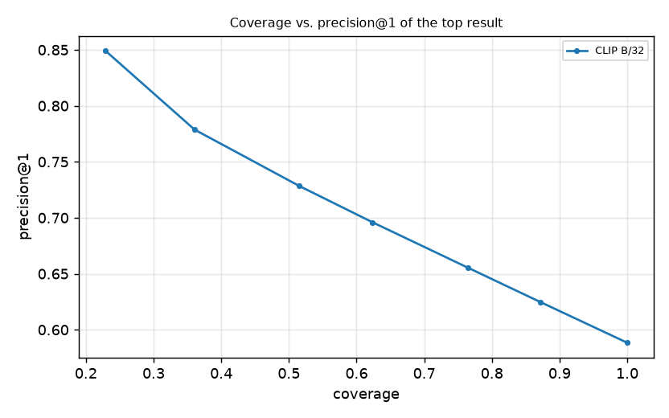
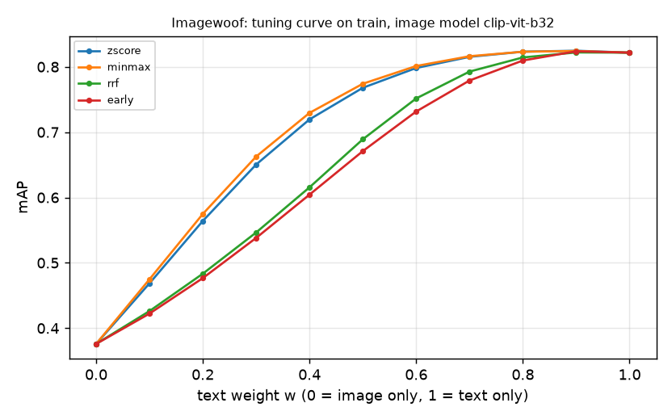
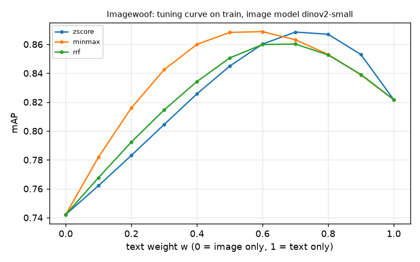
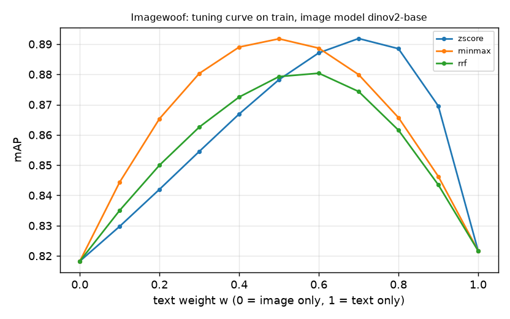
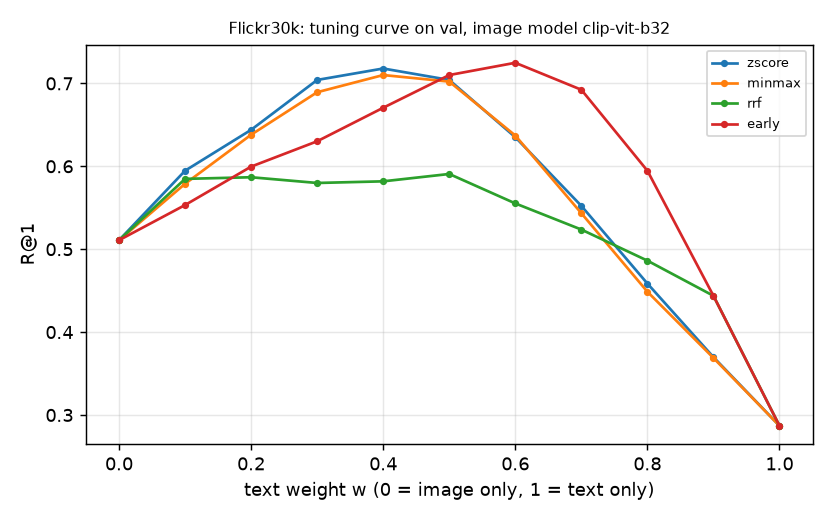
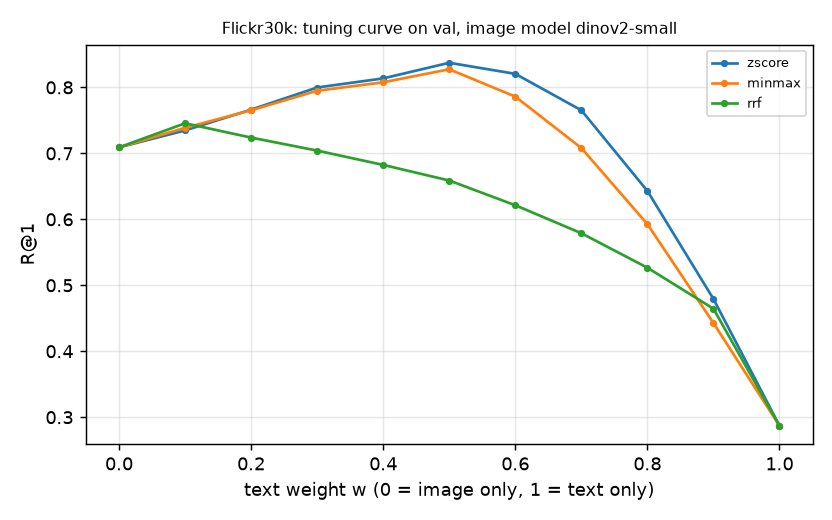
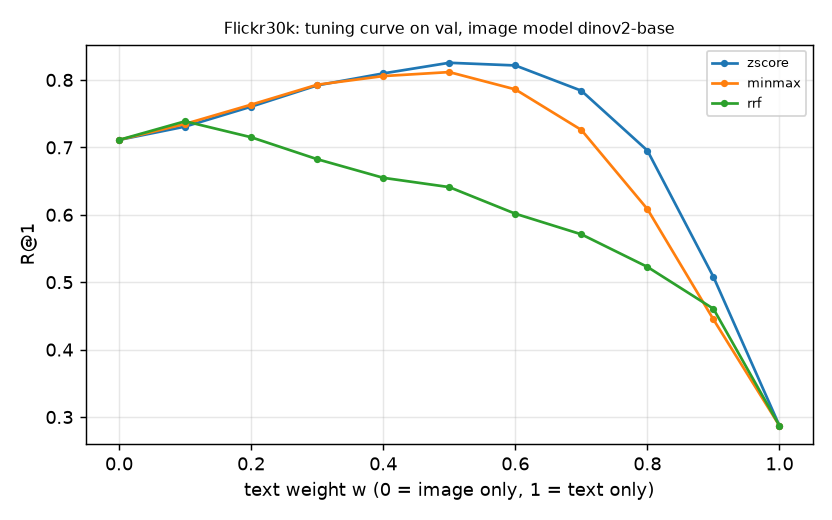
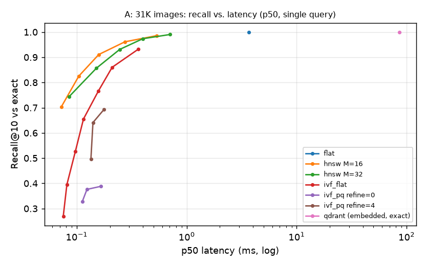

# Generated result tables

_Auto-generated by `scripts/make_report.py` from `results/*.json`. Do not edit by hand. Metrics are percentages unless noted._

## Text↔image retrieval: CLIP model comparison (Flickr30k test)

`results/models_text_image.json` · generated 2026-10-19T00:39:36+00:00 · commit 5284876 · NVIDIA GeForce RTX 4050 Laptop GPU

Zero-shot retrieval on the Karpathy test split (1,000 images, 5,000 captions). 'full' adds all 29,000 Flickr30k train images as distractors (30,000-image gallery). Exact (flat) search. Significance: clustered paired bootstrap over test images vs. the CLIP ViT-B/32 baseline.

**Retrieval quality**

| Model | Task | R@1 | R@5 | R@10 | MRR | Median rank | vs. B/32 (R@1) |
|---|---|---|---|---|---|---|---|
| clip-vit-b32 | T→I (1000 imgs) | 58.8 | 83.4 | 90.1 | 69.7 | 1 |  |
| clip-vit-b16 | T→I (1000 imgs) | 62.2 | 85.6 | 91.9 | 72.6 | 1 | +3.4 pts (p=0.000) |
| clip-vit-l14 | T→I (1000 imgs) | 64.7 | 87.1 | 92.2 | 74.6 | 1 | +5.9 pts (p=0.000) |
| clip-vit-b32 | T→I (29994 imgs) | 19.8 | 40.3 | 49.8 | 29.9 | – |  |
| clip-vit-b16 | T→I (29994 imgs) | 23.2 | 43.6 | 54.2 | 33.3 | – | +3.3 pts (p=0.000) |
| clip-vit-l14 | T→I (29994 imgs) | 27.4 | 48.7 | 58.4 | 37.6 | – | +7.5 pts (p=0.000) |
| clip-vit-b32 | I→T (5000 captions) | 79.3 | 95.0 | 98.1 | 86.0 | 1 | mAP=64.2 |
| clip-vit-b16 | I→T (5000 captions) | 82.4 | 96.7 | 99.0 | 88.6 | 1 | mAP=67.0 |
| clip-vit-l14 | I→T (5000 captions) | **85.3** | **97.4** | **99.3** | **90.5** | 1 | mAP=71.0 |

## Image↔image retrieval: CLIP vs. DINOv2

`results/models_image_image.json` · generated 2026-10-19T00:40:24+00:00 · commit 5284876 · NVIDIA GeForce RTX 4050 Laptop GPU

Category level: Imagewoof val (3,928 images, 10 dog breeds), every image queries all others; relevant = same breed (~390 per query), so mAP is meaningful. Instance level: one transformed copy of each Flickr30k test image (crop 30-60% area, colour jitter, blur+JPEG q15-35, rotation ±25°, flip+crop; cycled) searched against the 30,000-image gallery; relevant = the untransformed original.

**Category-level (Imagewoof)**

| Model | mAP | R@1 (P@1) | P@10 | MRR | ΔmAP vs CLIP B/32 |
|---|---|---|---|---|---|
| clip-vit-b32 | 36.8 | 79.9 | 73.0 | 86.5 |  |
| clip-vit-b16 | 40.0 | 84.0 | 77.7 | 89.6 | +3.2 (p=0.000) |
| clip-vit-l14 | 49.6 | 89.6 | 85.5 | 93.1 | +12.8 (p=0.000) |
| dinov2-small | 75.0 | 93.7 | 91.2 | 95.7 | +38.2 (p=0.000) |
| dinov2-base | **82.5** | **94.8** | **93.3** | **96.3** | +45.7 (p=0.000) |
| dinov2-small [pooling=mean] | 37.7 | 80.6 | 71.4 | 86.9 | +0.9 (p=0.000) |
| dinov2-small [pooling=cls+mean] | 72.0 | 93.0 | 90.3 | 95.3 | +35.2 (p=0.000) |
| dinov2-base [pooling=cls+mean] | 80.9 | 94.7 | 93.0 | 96.3 | +44.1 (p=0.000) |

**Instance-level copy detection (Flickr30k test vs 30K gallery)**

| Model | R@1 | R@10 | MRR | R@1 crop | R@1 color | R@1 blur_jpeg | R@1 rotate | R@1 flip_crop |
|---|---|---|---|---|---|---|---|---|
| clip-vit-b32 | 96.4 | 98.6 | 97.2 | 95.5 | **100.0** | 96.0 | 99.0 | 91.5 |
| clip-vit-b16 | 97.2 | 99.0 | 97.9 | 96.0 | **100.0** | 96.0 | **100.0** | 94.0 |
| clip-vit-l14 | 96.5 | 98.9 | 97.4 | 98.0 | 99.5 | 93.0 | **100.0** | 92.0 |
| dinov2-small | 97.7 | 99.3 | 98.3 | **99.0** | **100.0** | **99.0** | 99.5 | 91.0 |
| dinov2-base | **98.3** | **99.5** | **98.7** | **99.0** | **100.0** | 98.0 | **100.0** | **94.5** |

## Preprocessing ablations

`results/preprocessing.json` · generated 2026-10-19T00:40:54+00:00 · commit 5284876 · NVIDIA GeForce RTX 4050 Laptop GPU

CLIP/DINOv2 resize the short side then centre-crop a square, discarding the edges of wide images. 'pad' letterboxes the full image onto a square canvas (mean colour) instead. Also tests prefixing captions with a prompt template. Δ = paired bootstrap vs. the default (clustered by image for T→I), 95% CI and p-value.

**Ablations**

| Model | Metric | Split | Variant | Value | MRR | Δ vs default |
|---|---|---|---|---|---|---|
| clip-vit-b32 | T→I R@1 | val | default (centre crop) | 0.597 | 70.9 |  |
| clip-vit-b32 | T→I R@1 | val | crop_mode=pad | 0.571 | 68.2 | -2.64 [-4.52, -0.89] p=0.006 |
| clip-vit-b32 | T→I R@1 | val | template 'a photo of {}' | 0.615 | 72.1 | +1.78 [+1.01, +2.52] p=0.000 |
| clip-vit-b32 | T→I R@1 | test | default (centre crop) | 0.588 | 69.7 |  |
| clip-vit-b32 | T→I R@1 | test | crop_mode=pad | 0.554 | 66.8 | -3.40 [-5.14, -1.64] p=0.001 |
| clip-vit-b32 | T→I R@1 | test | template 'a photo of {}' | 0.597 | 70.5 | +0.86 [+0.14, +1.60] p=0.020 |
| clip-vit-b32 | I→I mAP | imagewoof val | default (centre crop) | 0.368 | 86.5 |  |
| clip-vit-b32 | I→I mAP | imagewoof val | crop_mode=pad | 0.315 | 85.8 | -5.30 [-5.57, -5.03] p=0.000 |
| dinov2-small | I→I mAP | imagewoof val | default (centre crop) | 0.75 | 95.7 |  |
| dinov2-small | I→I mAP | imagewoof val | crop_mode=pad | 0.743 | 95.7 | -0.68 [-0.86, -0.51] p=0.000 |

## Score calibration

`results/calibration.json` · generated 2026-10-19T00:38:56+00:00 · commit 5284876 · NVIDIA GeForce RTX 4050 Laptop GPU

Background statistics and Platt scaling are fitted on validation data only; ECE/Brier on held-out data. Text: P(caption's annotated image) on Flickr30k. Image: P(same Imagewoof breed). Both use the true (heavily imbalanced) base rate via weighted negative sampling. The abstention table thresholds the calibrated P(match) of the top-1 text→image result on the test split.

**Calibration per embedding space and query modality**

| Model | Query | bg mean | bg std | bg p99 | ECE (fit split) | ECE (held-out) | Brier (held-out) | base rate |
|---|---|---|---|---|---|---|---|---|
| clip-vit-b32 | image | 0.487 | 0.0871 | 0.696 | 0.0113 | 0.0169 | 0.0843 | 0.1019 |
| clip-vit-b32 | text | 0.17 | 0.0423 | 0.272 | 0.0001 | 0.0001 | 0.0007 | 0.0010 |
| clip-vit-b16 | image | 0.507 | 0.0851 | 0.715 | 0.0126 | 0.0169 | 0.0830 | 0.1019 |
| clip-vit-b16 | text | 0.169 | 0.0422 | 0.272 | 0.0001 | 0.0001 | 0.0007 | 0.0010 |
| clip-vit-l14 | image | 0.517 | 0.0771 | 0.704 | 0.0142 | 0.0172 | 0.0789 | 0.1019 |
| clip-vit-l14 | text | 0.103 | 0.0441 | 0.213 | 0.0001 | 0.0001 | 0.0007 | 0.0010 |
| dinov2-small | image | 0.0859 | 0.0908 | 0.374 | 0.0078 | 0.0075 | 0.0457 | 0.1019 |
| dinov2-base | image | 0.0587 | 0.0748 | 0.322 | 0.0163 | 0.0148 | 0.0371 | 0.1019 |

**Abstention: answer only if top-1 P(match) ≥ threshold (CLIP B/32, T→I test)**

| Threshold | Coverage | Precision@1 on answered |
|---|---|---|
| 0 | 100.0 | 58.8 |
| 0.05 | 87.2 | 62.5 |
| 0.1 | 76.5 | 65.5 |
| 0.2 | 62.4 | 69.6 |
| 0.3 | 51.5 | 72.8 |
| 0.5 | 36.1 | 77.9 |
| 0.7 | 22.8 | 84.9 |

**Top-1 reliability (CLIP B/32, T→I test): predicted vs. observed**

| P(match) bin | Queries | Mean predicted | Observed precision@1 |
|---|---|---|---|
| [0.00, 0.05) | 641 | 0.0251 | 0.342 |
| [0.05, 0.10) | 535 | 0.0738 | 0.406 |
| [0.10, 0.20) | 706 | 0.146 | 0.476 |
| [0.20, 0.30) | 541 | 0.248 | 0.542 |
| [0.30, 0.50) | 774 | 0.39 | 0.611 |
| [0.50, 0.70) | 661 | 0.596 | 0.657 |
| [0.70, 1.00) | 1142 | 0.862 | 0.849 |

_P(match) is calibrated for a random (caption, image) pair, not for the top-ranked one; systematic under-prediction here is expected._

## Hard negatives and failure analysis (CLIP ViT-B/32, Flickr30k test T→I)

`results/hard_negatives.json` · generated 2026-10-19T00:41:03+00:00 · commit 5284876 · NVIDIA GeForce RTX 4050 Laptop GPU

2058 of 5000 queries miss at rank 1; 59.8% of those have the target in the top 5 (near misses). For 499 failures (24.2%) the wrongly top-ranked image has a human caption at least as similar to the query as the target's own other captions — i.e. the 'hard negative' is plausibly also a correct answer that Flickr30k's one-image-per-caption labels count as wrong. Category R@1 uses keyword heuristics; categories overlap.

**R@1 by query type**

| Query category | Queries | R@1 | R@1 95% CI | R@10 |
|---|---|---|---|---|
| all queries | 5000 | 58.8 | [56.6, 60.8] | 90.1 |
| counting | 1479 | 57.5 | [53.9, 61.0] | 89.5 |
| colour | 1625 | 63.9 | [60.8, 66.9] | 92.0 |
| spatial | 788 | 59.8 | [56.1, 63.7] | 89.7 |
| negation | 35 | 80.0 | [65.7, 91.7] | 94.3 |
| action | 3662 | 59.0 | [56.8, 61.4] | 89.6 |
| length 0-8 words | 1161 | 51.1 | [47.5, 54.5] | 84.2 |
| length 9-12 words | 1828 | 59.0 | [56.1, 61.9] | 90.9 |
| length 13-17 words | 1339 | 60.6 | [57.4, 63.8] | 92.1 |
| length 18-99 words | 672 | 68.2 | [63.9, 72.6] | 94.0 |

**Example failures**

| Query | Target rank | Top-1 image's first caption | sim(query, top-1 captions) | sim(query, target's other captions) |
|---|---|---|---|---|
| The man with pierced ears is wearing glasses and an orange hat. | 3 | An Asian man in a green uniform shirt with a white speckled headband is using a torch to cook food in a restaurant. | 0.602 | 0.888 |
| A man with gauges and glasses is wearing a Blitz hat. | 2 | A man smoking a cigarette and wearing a NY baseball cap is looking down at a camera. | 0.635 | 0.734 |
| A black and white dog is running through the grass. | 4 | Two dogs are fighting over a toy and another dog is chasing them. | 0.701 | 0.913 |
| A dog runs on the green grass near a wooden fence. | 4 | A brown dog with white paws is trotting through a field of green grass. | 0.809 | 0.786 |
| Girl about to kick a piece of wood in half while karate instructor holds it | 6 | Several children are practicing martial arts moves in a room with a red floor. | 0.8 | 0.851 |
| A girl kicking a stick that a man is holding in tae kwon do class. | 5 | The girl with the red belt is kicking a pad that the person in black is holding. | 0.848 | 0.851 |
| A girl in karate uniform breaking a stick with a front kick. | 2 | A young boy wearing a white tunic, white pants, and a yellow belt is standing on his left leg with his right leg extended in a karate pose. | 0.846 | 0.866 |
| A girl breaking boards by using karate. | 3 | A young boy wearing a white tunic, white pants, and a yellow belt is standing on his left leg with his right leg extended in a karate pose. | 0.825 | 0.863 |
| Two men on a rooftop while another man stands atop a ladder watching them | 2 | A man wearing a hat and a white shirt is cleaning windows. | 0.825 | 0.931 |
| Man taking a photograph of a well dressed group of teens. | 2 | A man in a black hat and blue shirt taking a picture on the side of an urban street. | 0.821 | 0.71 |
| A baseball player in red leaps into the air to avoid a player in blue, who is shortly behind him as he catches the ball, while other blue team members look on in the background. | 3 | A man in a black shirt and white pants swinging a baseball bat, with a baseball team and spectators in the background. | 0.806 | 0.749 |
| A baseball player coming into home plate with knee held high and the catcher right in front of him waiting for the ball. | 4 | A man dressed in orange t-shirt is trying to hit a baseball, with a few people looking at them and a keeper behind trying to catch the ball. | 0.889 | 0.917 |
| A baseball player attempting to score a run before the catcher tags the player out. | 3 | A man dressed in orange t-shirt is trying to hit a baseball, with a few people looking at them and a keeper behind trying to catch the ball. | 0.891 | 0.917 |
| A baseball catcher trying to tag a base runner in a baseball game. | 4 | The number ten player on the white softball team gets tagged at base by a girl on the other team. | 0.869 | 0.897 |
| A man wearing a hat and a white shirt is cleaning windows. | 9 | A man in a black hat and blue shirt taking a picture on the side of an urban street. | 0.653 | 0.675 |

## Hybrid text + image retrieval

`results/hybrid.json` · generated 2026-10-19T00:02:07+00:00 · commit 311aa5e · NVIDIA GeForce RTX 4050 Laptop GPU

Late fusion combines scores from separate indexes (never mixing vectors from different spaces); 'early' blends CLIP text and CLIP image query vectors. The text weight is tuned on the tuning split and applied once to the evaluation split. Δ is the paired bootstrap difference against the better single signal on the evaluation split (mAP for Imagewoof, R@1 for Flickr30k).

**Imagewoof val: breed name + exemplar image (primary metric mAP)**

| Query | Fusion | w_text (tuned) | mAP | R@1 | P@10 | Δ mAP vs best single signal |
|---|---|---|---|---|---|---|
| text only (CLIP B/32) | — | — | 83.0 | 89.4 | 92.6 |  |
| image only (clip-vit-b32) | — | — | 36.8 | 79.9 | 73.0 |  |
| text + image (clip-vit-b32) | zscore | 0.9 | 83.1 | 89.0 | 93.6 | +0.1 (p=0.000) |
| text + image (clip-vit-b32) | minmax | 0.9 | 83.1 | 88.7 | 93.6 | +0.1 (p=0.000) |
| text + image (clip-vit-b32) | rrf | 0.9 | 82.7 | 88.6 | 93.2 | -0.4 (p=0.000) |
| text + image (clip-vit-b32) | early | 0.9 | 82.9 | 87.5 | 94.7 | -0.1 (p=0.000) |
| image only (dinov2-small) | — | — | 75.0 | 93.7 | 91.2 |  |
| text + image (dinov2-small) | zscore | 0.7 | 87.4 | 96.9 | 96.5 | +4.4 (p=0.000) |
| text + image (dinov2-small) | minmax | 0.6 | 87.5 | 95.5 | 96.2 | +4.5 (p=0.000) |
| text + image (dinov2-small) | rrf | 0.7 | 86.1 | 97.0 | 95.0 | +3.0 (p=0.000) |
| image only (dinov2-base) | — | — | 82.5 | 94.8 | 93.3 |  |
| text + image (dinov2-base) | zscore | 0.7 | **89.6** | 97.2 | **96.6** | +6.6 (p=0.000) |
| text + image (dinov2-base) | minmax | 0.5 | 89.6 | 97.0 | 96.6 | +6.6 (p=0.000) |
| text + image (dinov2-base) | rrf | 0.6 | 87.9 | **97.8** | 96.0 | +4.9 (p=0.000) |

**Flickr30k test: caption + 15-25% fragment, 31K gallery (primary metric R@1)**

| Query | Fusion | w_text (tuned) | R@1 | R@5 | R@10 | Δ R@1 vs best single signal |
|---|---|---|---|---|---|---|
| text only (CLIP B/32) | — | — | 24.7 | 48.8 | 58.1 |  |
| image only (clip-vit-b32) | — | — | 51.4 | 69.0 | 74.0 |  |
| text + image (clip-vit-b32) | zscore | 0.4 | 71.3 | 87.2 | 91.0 | +19.9 (p=0.000) |
| text + image (clip-vit-b32) | minmax | 0.4 | 70.8 | 86.7 | 90.6 | +19.4 (p=0.000) |
| text + image (clip-vit-b32) | rrf | 0.5 | 57.4 | 80.7 | 87.8 | +6.0 (p=0.001) |
| text + image (clip-vit-b32) | early | 0.6 | 71.1 | 86.9 | 91.3 | +19.7 (p=0.000) |
| image only (dinov2-small) | — | — | 74.1 | 83.9 | 86.8 |  |
| text + image (dinov2-small) | zscore | 0.5 | **85.3** | **93.8** | **96.3** | +11.2 (p=0.000) |
| text + image (dinov2-small) | minmax | 0.5 | 83.2 | 93.5 | 95.6 | +9.1 (p=0.000) |
| text + image (dinov2-small) | rrf | 0.1 | 77.6 | 86.4 | 88.5 | +3.5 (p=0.001) |
| image only (dinov2-base) | — | — | 73.5 | 83.0 | 85.5 |  |
| text + image (dinov2-base) | zscore | 0.5 | 83.3 | 92.7 | 94.6 | +9.8 (p=0.000) |
| text + image (dinov2-base) | minmax | 0.5 | 81.3 | 91.8 | 94.5 | +7.8 (p=0.000) |
| text + image (dinov2-base) | rrf | 0.1 | 73.9 | 85.2 | 88.1 | +0.4 (p=0.770) |

## Reranking

`results/rerank.json` · generated 2026-10-18T23:56:57+00:00 · commit 7767a85 · NVIDIA GeForce RTX 4050 Laptop GPU

First stage: exact CLIP ViT-B/32 search, C=100 candidates (test Recall@100 = 99.2%, the ceiling for any reranker). Hyper-parameters selected by MRR on val; test evaluated once. Δ R@1 = paired clustered bootstrap vs. baseline [95% CI], p-value. The cross-encoder rescores the top 20 only. Latency is the extra time per query for the second stage.

**Text→image reranking (Flickr30k, 1K gallery)**

| Method | Selected on val | val R@1 | test R@1 | test R@5 | test R@10 | test MRR | Δ test R@1 vs baseline | +ms/query |
|---|---|---|---|---|---|---|---|---|
| baseline (CLIP B/32, exact) | - | 59.7 | 58.8 | 83.4 | 90.1 | 69.7 |  | – |
| PRF / AQE in CLIP space | m=5, λ=0.1, softmax | 59.7 | 58.8 | 83.5 | 90.0 | 69.7 | -0.1 [-0.3, +0.2] p=0.613 | 0.1 |
| visual PRF (DINOv2-S) | m=5, λ=0.3, uniform | 60.3 | 58.9 | 83.6 | 90.7 | 69.9 | +0.0 [-0.6, +0.7] p=0.987 | 0.07 |
| visual PRF (DINOv2-B) | m=10, λ=0.5, softmax | 60.1 | 58.6 | 83.9 | 90.5 | 69.8 | -0.2 [-0.7, +0.3] p=0.501 | 0.13 |
| BLIP ITM cross-encoder (ITM only) | top-20, γ=1.0 | 83.4 | **83.2** | **93.0** | **93.8** | **87.7** | +24.4 [+22.6, +26.3] p=0.000 | 58.5 |
| BLIP ITM cross-encoder (mixed) | top-20, γ=1.0 | 83.4 | **83.2** | **93.0** | **93.8** | **87.7** | +24.4 [+22.6, +26.3] p=0.000 | 58.5 |

**Image→image average query expansion (Imagewoof mAP; tuned on train)**

| Model | Selected | train base | train AQE | val base | val AQE |
|---|---|---|---|---|---|
| dinov2-small | m=10, λ=0.6 | 0.742 | 0.785 | 0.75 | 0.759 |
| clip-vit-b32 | m=5, λ=0.6 | 0.376 | 0.391 | 0.368 | 0.378 |

## Exact vs. approximate nearest-neighbour search

`results/ann_benchmark.json` · generated 2026-10-19T00:08:15+00:00 · commit 311aa5e · NVIDIA GeForce RTX 4050 Laptop GPU

CLIP ViT-B/32 (512-d, inner product on L2-normalised vectors). Queries: 5,000 Flickr30k test captions. CPU, FAISS 1.15.1, 12 OpenMP threads. Index MB = serialised FAISS index (PQ codes are 32 bytes/vector vs 2,048 for float32). The embedded Qdrant mode is exact brute force in Python and is shown only to validate the backend, not as a Qdrant server benchmark. Recall and latency are measured with k=10; 'Task R@K' (is the annotated image retrieved?) comes from a separate depth-100 search, for which HNSW uses efSearch >= 100.

**A: 31K images (n=31,008)**

| Index | Recall@10 vs exact | p50 ms | p95 ms | Build s | Index MB | Task R@1 | Task R@10 |
|---|---|---|---|---|---|---|---|
| flat | 100.0 | 3.67 | 8.97 | 0.18 | 63.5 | 19.5 | 49.5 |
| hnsw M=16 ef_search=16 | 70.3 | 0.072 | 0.097 | 3.62 | 68 | 19.0 | 47.9 |
| hnsw M=16 ef_search=32 | 82.5 | 0.104 | 0.157 | 3.62 | 68 | 19.0 | 47.9 |
| hnsw M=16 ef_search=64 | 91.1 | 0.158 | 0.22 | 3.62 | 68 | 19.0 | 47.9 |
| hnsw M=16 ef_search=128 | 96.1 | 0.274 | 0.388 | 3.62 | 68 | 19.1 | 48.2 |
| hnsw M=16 ef_search=256 | 98.6 | 0.532 | 0.715 | 3.62 | 68 | 19.3 | 48.9 |
| hnsw M=32 ef_search=16 | 74.3 | 0.085 | 0.125 | 3.92 | 71.9 | 19.1 | 48.1 |
| hnsw M=32 ef_search=32 | 85.7 | 0.151 | 0.205 | 3.92 | 71.9 | 19.1 | 48.1 |
| hnsw M=32 ef_search=64 | 93.1 | 0.245 | 0.327 | 3.92 | 71.9 | 19.1 | 48.1 |
| hnsw M=32 ef_search=128 | 97.4 | 0.398 | 0.544 | 3.92 | 71.9 | 19.2 | 48.4 |
| hnsw M=32 ef_search=256 | 99.0 | 0.707 | 0.9 | 3.92 | 71.9 | 19.3 | 49.0 |
| ivf_flat nprobe=1 | 26.9 | 0.075 | 0.101 | 3.39 | 65.2 | 9.0 | 20.1 |
| ivf_flat nprobe=2 | 39.5 | 0.081 | 0.094 | 3.39 | 65.2 | 11.4 | 26.5 |
| ivf_flat nprobe=4 | 52.7 | 0.097 | 0.116 | 3.39 | 65.2 | 13.0 | 31.6 |
| ivf_flat nprobe=8 | 65.5 | 0.115 | 0.14 | 3.39 | 65.2 | 15.2 | 37.3 |
| ivf_flat nprobe=16 | 76.6 | 0.157 | 0.248 | 3.39 | 65.2 | 16.6 | 41.5 |
| ivf_flat nprobe=32 | 86.0 | 0.21 | 0.262 | 3.39 | 65.2 | 18.2 | 44.9 |
| ivf_flat nprobe=64 | 93.2 | 0.361 | 0.478 | 3.39 | 65.2 | 18.6 | 47.2 |
| ivf_pq refine=0 nprobe=4 | 32.8 | 0.112 | 0.144 | 6.57 | 3.2 | 7.2 | 24.9 |
| ivf_pq refine=0 nprobe=16 | 37.6 | 0.124 | 0.148 | 6.57 | 3.2 | 7.9 | 29.3 |
| ivf_pq refine=0 nprobe=64 | 38.8 | 0.166 | 0.19 | 6.57 | 3.2 | 8.2 | 30.6 |
| ivf_pq refine=4 nprobe=4 | 49.6 | 0.134 | 0.297 | 6.25 | 3.2 | 13.0 | 31.6 |
| ivf_pq refine=4 nprobe=16 | 64.1 | 0.14 | 0.157 | 6.25 | 3.2 | 16.6 | 41.5 |
| ivf_pq refine=4 nprobe=64 | 69.3 | 0.177 | 0.268 | 6.25 | 3.2 | 18.6 | 47.0 |
| qdrant (embedded, exact) | 100.0 | 85.5 | 125 | 2.65 | – | – | – |

**B: 181K mixed (n=181,048)**

| Index | Recall@10 vs exact | p50 ms | p95 ms | Build s | Index MB |
|---|---|---|---|---|---|
| flat | 100.0 | 21 | 30.3 | 0.95 | 371 |
| hnsw M=16 ef_search=16 | 89.4 | 0.08 | 0.105 | 32.5 | 397 |
| hnsw M=16 ef_search=32 | 95.5 | 0.118 | 0.164 | 32.5 | 397 |
| hnsw M=16 ef_search=64 | 98.4 | 0.177 | 0.243 | 32.5 | 397 |
| hnsw M=16 ef_search=128 | 99.5 | 0.304 | 0.423 | 32.5 | 397 |
| hnsw M=16 ef_search=256 | 99.8 | 0.55 | 0.714 | 32.5 | 397 |
| hnsw M=32 ef_search=16 | 91.8 | 0.097 | 0.135 | 38.7 | 420 |
| hnsw M=32 ef_search=32 | 96.6 | 0.136 | 0.193 | 38.7 | 420 |
| hnsw M=32 ef_search=64 | 98.7 | 0.205 | 0.293 | 38.7 | 420 |
| hnsw M=32 ef_search=128 | 99.6 | 0.347 | 0.494 | 38.7 | 420 |
| hnsw M=32 ef_search=256 | 99.8 | 0.643 | 0.865 | 38.7 | 420 |
| ivf_flat nprobe=1 | 47.7 | 0.141 | 0.175 | 35.7 | 376 |
| ivf_flat nprobe=2 | 64.0 | 0.162 | 0.213 | 35.7 | 376 |
| ivf_flat nprobe=4 | 77.6 | 0.191 | 0.28 | 35.7 | 376 |
| ivf_flat nprobe=8 | 87.0 | 0.243 | 0.334 | 35.7 | 376 |
| ivf_flat nprobe=16 | 92.8 | 0.355 | 0.542 | 35.7 | 376 |
| ivf_flat nprobe=32 | 96.5 | 0.57 | 0.892 | 35.7 | 376 |
| ivf_flat nprobe=64 | 98.4 | 0.999 | 1.47 | 35.7 | 376 |
| ivf_pq refine=0 nprobe=4 | 43.1 | 0.166 | 0.202 | 40.6 | 11.3 |
| ivf_pq refine=0 nprobe=16 | 45.0 | 0.192 | 0.292 | 40.6 | 11.3 |
| ivf_pq refine=0 nprobe=64 | 45.1 | 0.278 | 0.337 | 40.6 | 11.3 |
| ivf_pq refine=4 nprobe=4 | 68.1 | 0.196 | 0.222 | 41.1 | 11.3 |
| ivf_pq refine=4 nprobe=16 | 74.7 | 0.22 | 0.259 | 41.1 | 11.3 |
| ivf_pq refine=4 nprobe=64 | 75.5 | 0.313 | 0.419 | 41.1 | 11.3 |

## Metadata-filtered search

`results/filtered_search.json` · generated 2026-10-19T00:42:45+00:00 · commit 5284876 · NVIDIA GeForce RTX 4050 Laptop GPU

300 Flickr30k test captions against the 31K CLIP B/32 gallery, k=10. Recall@10 is measured against the exact top-10 *among allowed images*; 'full results' is the fraction of queries that returned k results. Post-filtering over-fetches 4k.

**Filtered retrieval**

| Filter | Allowed | Index | Strategy | Recall@10 | Full results | p50 ms | p95 ms |
|---|---|---|---|---|---|---|---|
| random 0.1% | 31 | flat | post-filter | 0.4 | 0.0 | 7.15 | 16.6 |
| random 0.1% | 31 | flat | pre-filter | 100.0 | 100.0 | 0.199 | 0.394 |
| random 0.1% | 31 | flat | exact-subset | 100.0 | 100.0 | 0.05 | 0.063 |
| random 0.1% | 31 | hnsw | post-filter | 0.4 | 0.0 | 0.644 | 1.13 |
| random 0.1% | 31 | hnsw | pre-filter | 15.7 | 0.0 | 0.852 | 1.41 |
| random 0.1% | 31 | ivf_flat | post-filter | 0.4 | 0.0 | 0.279 | 0.536 |
| random 0.1% | 31 | ivf_flat | pre-filter | 5.9 | 0.0 | 0.131 | 0.182 |
| random 1.0% | 310 | flat | post-filter | 4.5 | 0.0 | 10.4 | 24.4 |
| random 1.0% | 310 | flat | pre-filter | 100.0 | 100.0 | 0.519 | 1.29 |
| random 1.0% | 310 | flat | exact-subset | 100.0 | 100.0 | 0.249 | 0.558 |
| random 1.0% | 310 | hnsw | post-filter | 4.6 | 0.0 | 0.91 | 1.59 |
| random 1.0% | 310 | hnsw | pre-filter | 60.2 | 94.3 | 1.22 | 2.07 |
| random 1.0% | 310 | ivf_flat | post-filter | 4.6 | 0.0 | 0.31 | 0.675 |
| random 1.0% | 310 | ivf_flat | pre-filter | 32.3 | 32.0 | 0.284 | 0.824 |
| random 5.0% | 1550 | flat | post-filter | 19.9 | 0.0 | 12.6 | 24 |
| random 5.0% | 1550 | flat | pre-filter | 100.0 | 100.0 | 1.78 | 3 |
| random 5.0% | 1550 | flat | exact-subset | 100.0 | 100.0 | 3.33 | 9.32 |
| random 5.0% | 1550 | hnsw | post-filter | 19.7 | 0.0 | 0.843 | 1.53 |
| random 5.0% | 1550 | hnsw | pre-filter | 85.2 | 100.0 | 1.6 | 2.35 |
| random 5.0% | 1550 | ivf_flat | post-filter | 19.6 | 0.0 | 0.251 | 0.58 |
| random 5.0% | 1550 | ivf_flat | pre-filter | 55.3 | 100.0 | 0.712 | 1.2 |
| random 20.0% | 6201 | flat | post-filter | 74.3 | 21.0 | 11.3 | 21.2 |
| random 20.0% | 6201 | flat | pre-filter | 100.0 | 100.0 | 5.42 | 7.61 |
| random 20.0% | 6201 | flat | exact-subset | 100.0 | 100.0 | 9.8 | 19.4 |
| random 20.0% | 6201 | hnsw | post-filter | 73.2 | 21.3 | 0.939 | 1.7 |
| random 20.0% | 6201 | hnsw | pre-filter | 94.3 | 100.0 | 3.67 | 5.56 |
| random 20.0% | 6201 | ivf_flat | post-filter | 60.7 | 22.0 | 0.266 | 0.597 |
| random 20.0% | 6201 | ivf_flat | pre-filter | 67.6 | 100.0 | 2.83 | 5.04 |
| random 50.0% | 15504 | flat | post-filter | 100.0 | 100.0 | 9.33 | 18.8 |
| random 50.0% | 15504 | flat | pre-filter | 100.0 | 100.0 | 8.06 | 10.7 |
| random 50.0% | 15504 | flat | exact-subset | 100.0 | 100.0 | 19.7 | 32.7 |
| random 50.0% | 15504 | hnsw | post-filter | 96.9 | 99.7 | 0.867 | 1.51 |
| random 50.0% | 15504 | hnsw | pre-filter | 96.9 | 100.0 | 5.08 | 6.29 |
| random 50.0% | 15504 | ivf_flat | post-filter | 74.7 | 100.0 | 0.306 | 0.627 |
| random 50.0% | 15504 | ivf_flat | pre-filter | 74.7 | 100.0 | 5.93 | 7.71 |
| orientation=portrait | 8443 | flat | post-filter | 86.0 | 65.0 | 11.3 | 23.2 |
| orientation=portrait | 8443 | flat | pre-filter | 100.0 | 100.0 | 5.04 | 6.35 |
| orientation=portrait | 8443 | flat | exact-subset | 100.0 | 100.0 | 11.2 | 20.1 |
| orientation=portrait | 8443 | hnsw | post-filter | 83.8 | 65.3 | 0.849 | 1.55 |
| orientation=portrait | 8443 | hnsw | pre-filter | 95.5 | 100.0 | 3.46 | 4.4 |
| orientation=portrait | 8443 | ivf_flat | post-filter | 64.5 | 62.7 | 0.254 | 0.508 |
| orientation=portrait | 8443 | ivf_flat | pre-filter | 70.2 | 100.0 | 2.69 | 3.59 |
| split=test | 1000 | flat | post-filter | 18.8 | 0.0 | 8.62 | 18.5 |
| split=test | 1000 | flat | pre-filter | 100.0 | 100.0 | 0.58 | 1.04 |
| split=test | 1000 | flat | exact-subset | 100.0 | 100.0 | 1.18 | 5.02 |
| split=test | 1000 | hnsw | post-filter | 18.6 | 0.0 | 0.812 | 1.24 |
| split=test | 1000 | hnsw | pre-filter | 81.9 | 100.0 | 1.12 | 1.8 |
| split=test | 1000 | ivf_flat | post-filter | 17.4 | 0.0 | 0.241 | 0.626 |
| split=test | 1000 | ivf_flat | pre-filter | 53.2 | 99.7 | 0.406 | 0.653 |

## Embedding throughput and memory

`results/throughput.json` · generated 2026-10-19T00:22:50+00:00 · commit 311aa5e · NVIDIA GeForce RTX 4050 Laptop GPU

Images: 256 Flickr30k test images already decoded in memory (fewer on CPU for large models); time includes the model's own resize/crop/normalise. GPU memory = peak allocated by PyTorch; CPU memory = peak process RSS during the run above the pre-load baseline (weights + activations + preprocessing; sampled every 5 ms). GPU throughput for small models is bounded by CPU-side PIL preprocessing. fp32 throughout, TF32 disabled. CPU uses 8 PyTorch threads.

**Throughput**

| Device | Model | Input | Batch | items/s | ms/item | Peak MB |
|---|---|---|---|---|---|---|
| cuda | clip-vit-b32 | image (incl. preprocessing) | 1 | 149 | 6.72 | 617 |
| cuda | clip-vit-b32 | image (incl. preprocessing) | 8 | 222 | 4.5 | 641 |
| cuda | clip-vit-b32 | image (incl. preprocessing) | 32 | 213 | 4.69 | 712 |
| cuda | clip-vit-b32 | image (incl. preprocessing) | 64 | 208 | 4.81 | 811 |
| cuda | clip-vit-b32 | text | 1 | 386 | 2.59 | – |
| cuda | clip-vit-b32 | text | 64 | 1,305 | 0.77 | – |
| cuda | clip-vit-b32 | text | 256 | 1,063 | 0.94 | – |
| cuda | clip-vit-b16 | image (incl. preprocessing) | 1 | 78.2 | 12.8 | 620 |
| cuda | clip-vit-b16 | image (incl. preprocessing) | 8 | 93.4 | 10.7 | 692 |
| cuda | clip-vit-b16 | image (incl. preprocessing) | 32 | 89.4 | 11.2 | 939 |
| cuda | clip-vit-b16 | image (incl. preprocessing) | 64 | 88.9 | 11.2 | 1,269 |
| cuda | clip-vit-b16 | text | 1 | 410 | 2.44 | – |
| cuda | clip-vit-b16 | text | 64 | 1,272 | 0.79 | – |
| cuda | clip-vit-b16 | text | 256 | 1,053 | 0.95 | – |
| cuda | clip-vit-l14 | image (incl. preprocessing) | 1 | 20.5 | 48.7 | 1,741 |
| cuda | clip-vit-l14 | image (incl. preprocessing) | 8 | 25 | 40 | 1,859 |
| cuda | clip-vit-l14 | image (incl. preprocessing) | 32 | 24.5 | 40.8 | 2,278 |
| cuda | clip-vit-l14 | image (incl. preprocessing) | 64 | 24.6 | 40.7 | 2,840 |
| cuda | clip-vit-l14 | text | 1 | 278 | 3.59 | – |
| cuda | clip-vit-l14 | text | 64 | 638 | 1.57 | – |
| cuda | clip-vit-l14 | text | 256 | 533 | 1.88 | – |
| cuda | dinov2-small | image (incl. preprocessing) | 1 | 125 | 8.01 | 104 |
| cuda | dinov2-small | image (incl. preprocessing) | 8 | 169 | 5.93 | 141 |
| cuda | dinov2-small | image (incl. preprocessing) | 32 | 160 | 6.23 | 269 |
| cuda | dinov2-small | image (incl. preprocessing) | 64 | 145 | 6.89 | 439 |
| cuda | dinov2-base | image (incl. preprocessing) | 1 | 64.3 | 15.5 | 366 |
| cuda | dinov2-base | image (incl. preprocessing) | 8 | 75.3 | 13.3 | 436 |
| cuda | dinov2-base | image (incl. preprocessing) | 32 | 73.1 | 13.7 | 678 |
| cuda | dinov2-base | image (incl. preprocessing) | 64 | 71.7 | 13.9 | 1,000 |
| cpu | clip-vit-b32 | image (incl. preprocessing) | 1 | 11.9 | 84.3 | 369 |
| cpu | clip-vit-b32 | image (incl. preprocessing) | 8 | 18 | 55.4 | 405 |
| cpu | clip-vit-b32 | image (incl. preprocessing) | 32 | 18.6 | 53.7 | 519 |
| cpu | clip-vit-b32 | image (incl. preprocessing) | 64 | 18.8 | 53.2 | 663 |
| cpu | clip-vit-b32 | text | 1 | 51 | 19.6 | – |
| cpu | clip-vit-b32 | text | 64 | 60.2 | 16.6 | – |
| cpu | clip-vit-b32 | text | 256 | 47.9 | 20.9 | – |
| cpu | clip-vit-b16 | image (incl. preprocessing) | 1 | 4.6 | 218 | 355 |
| cpu | clip-vit-b16 | image (incl. preprocessing) | 8 | 5.2 | 194 | 426 |
| cpu | clip-vit-b16 | image (incl. preprocessing) | 32 | 5 | 198 | 543 |
| cpu | clip-vit-b16 | image (incl. preprocessing) | 64 | 6.3 | 159 | 787 |
| cpu | clip-vit-b16 | text | 1 | 50.9 | 19.6 | – |
| cpu | clip-vit-b16 | text | 64 | 60.9 | 16.4 | – |
| cpu | clip-vit-b16 | text | 256 | 68.4 | 14.6 | – |
| cpu | clip-vit-l14 | image (incl. preprocessing) | 1 | 1 | 970 | 876 |
| cpu | clip-vit-l14 | image (incl. preprocessing) | 8 | 1.3 | 753 | 985 |
| cpu | clip-vit-l14 | image (incl. preprocessing) | 32 | 1.2 | 823 | 1,168 |
| cpu | clip-vit-l14 | image (incl. preprocessing) | 64 | 1.2 | 802 | 1,661 |
| cpu | clip-vit-l14 | text | 1 | 36.6 | 27.3 | – |
| cpu | clip-vit-l14 | text | 64 | 31.4 | 31.9 | – |
| cpu | clip-vit-l14 | text | 256 | 26.8 | 37.2 | – |
| cpu | dinov2-small | image (incl. preprocessing) | 1 | 16.5 | 60.5 | 95 |
| cpu | dinov2-small | image (incl. preprocessing) | 8 | 19.7 | 50.9 | 165 |
| cpu | dinov2-small | image (incl. preprocessing) | 32 | 13.6 | 73.8 | 382 |
| cpu | dinov2-small | image (incl. preprocessing) | 64 | 12.9 | 77.4 | 525 |
| cpu | dinov2-base | image (incl. preprocessing) | 1 | 5.3 | 190 | 346 |
| cpu | dinov2-base | image (incl. preprocessing) | 8 | 5.8 | 172 | 403 |
| cpu | dinov2-base | image (incl. preprocessing) | 32 | 4 | 247 | 675 |
| cpu | dinov2-base | image (incl. preprocessing) | 64 | 5.8 | 173 | 952 |

## End-to-end query latency (serving configuration)

`results/query_latency.json` · generated 2026-10-19T00:44:41+00:00 · commit 5284876 · NVIDIA GeForce RTX 4050 Laptop GPU

In-process SearchEngine, flat index over the full catalogue (35,986 images), models on cuda. Excludes HTTP and image decoding of uploads; includes query embedding (query cache cleared per query type), search, fusion/reranking. Stage medians in ms.

**Latency**

| Query type | n | p50 ms | p95 ms | Stage medians (ms) |
|---|---|---|---|---|
| text | 300 | 19.3 | 31.5 | embed_query 7.5, search 9.8 |
| text + PRF | 300 | 22.7 | 35.5 | embed_query 7.6, search 11.9, rerank 0.7 |
| text + visual PRF | 300 | 25 | 41.8 | embed_query 8.4, search 12.2, rerank 0.6 |
| text + cross-encoder (top 20) | 60 | 567 | 663 | embed_query 5.1, search 10.0, rerank 552.1 |
| image upload (DINOv2-S) | 300 | 27.7 | 37.5 | embed_query 16.6, search 8.5 |
| image upload (CLIP B/32) | 300 | 28.1 | 42.5 | embed_query 14.3, search 10.7 |
| find similar by id | 300 | 7.98 | 16.3 | embed_query 0.1, search 6.5 |
| hybrid (zscore) | 300 | 44.4 | 59.4 | embed_query 22.7, search 18.3, fuse 1.4 |
| text + filter (portrait) | 300 | 21.7 | 24.6 | embed_query 4.5, filter 11.2, search 5.4 |
